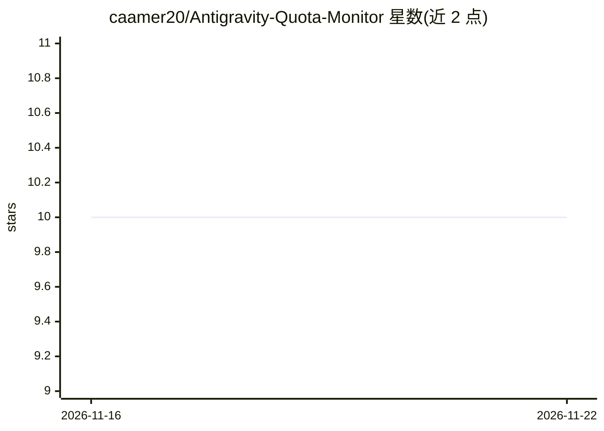

# caamer20/Antigravity-Quota-Monitor

⭐ 10 · TypeScript · 推送 2026-02-20 · [GitHub](https://github.com/caamer20/Antigravity-Quota-Monitor) · [官网](https://www.cameronamer.com) · 个人维护

**Antigravity 状态栏扩展：实时监控各模型配额余量**

面向 Antigravity IDE 的状态栏扩展，每 5 秒查询本地 Antigravity Language Server 获取当前激活模型的配额使用情况，无需手动配置或 API key（自动从运行进程中读取端口与 CSRF token）。提供绿/黄/红三色余量指示（100%、50-99%、低于 50%），悬停可查看全部模型的用量列表，点击火箭图标可手动选择模型。Mac 平台通过下载 zip 包运行 install.sh 安装。

## 筛选速览

| 维度 | 判定 | 备注 |
|---|---|---|
| AI 角色 | `ai-ecosystem` | LLM/agent 周边工具 |
| 许可风险 | `none` | — |
| 部署形态 | `desktop` | 安装包/桌面程序 |
| 模型依赖 | — | README 未给出锁定关系 |
| 硬件要求 | — | 无带数字的原话,不猜 |
| 安装摩擦 | `low` | 无编译、无系统依赖或容器化 |
| 成熟度 | — | 结构信号不足 |

## 能力要点

- 每 5 秒自动刷新配额余量并跟随当前激活模型
- 绿/黄/红三色状态指示与悬停查看全部模型用量
- 自动从本地运行进程读取端口与 CSRF token，无需 API key

## 适用场景

- 在 Antigravity 中监控各模型配额消耗进度
- 配额告急时通过颜色提示及时切换用量策略

## 场景标签

 · 领域:开发工具/IDE 扩展

## 证据(README 行号)

> L3: Status bar extension for Antigravity that shows model quota usage.
> L32: The extension queries the local Antigravity Language Server. It finds the port and CSRF token from the running proc

## 星数曲线

2026-11-16 10 → 2026-11-22 10（+0）

---
*卡片 v1 · prompt 1.4 · 生成 2026-11-19 · 置信度 high · 依据 README sha `b3beb84e1809` · [字段定义](../../DATASET.md)*
