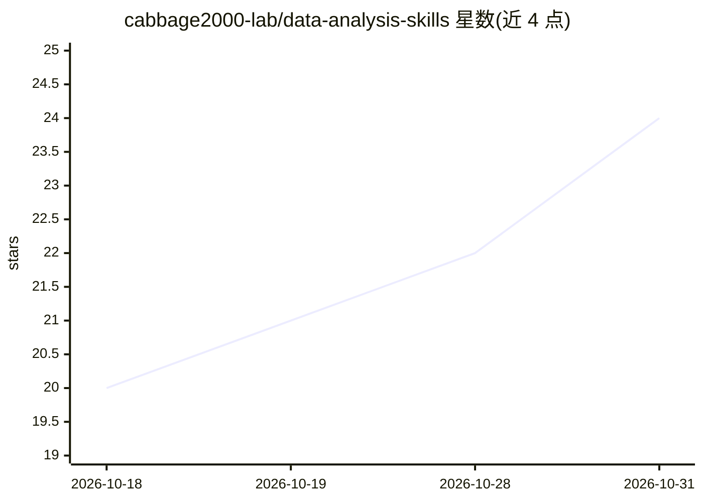

# cabbage2000-lab/data-analysis-skills

⭐ 24 · HTML · MIT · 推送 2026-10-10 · [GitHub](https://github.com/cabbage2000-lab/data-analysis-skills) · 个人维护 · 中文 README

**装进编程智能体的数据分析 skill：数据文件变交互式 HTML 分析报告**

一个跨宿主的 Agent Skill 包，可装入 Claude Code、Codex CLI、WorkBuddy 等编程智能体。用户提供 CSV/Excel/JSON/TSV 数据并表达分析诉求后，skill 引导智能体先确认行业、目标与受众，再执行数据理解、清洗、指标计算与分析，交付单文件 HTML 交互报告（固定六段式、结论先行、每图配解读、处理过程记录于附录）。含统计纪律约束：不杜撰行业基准、相关不判因果、小样本标注可信度限制。分析由智能体本地用 Python 执行，报告图表库经 CDN 加载需联网。

## 筛选速览

| 维度 | 判定 | 备注 |
|---|---|---|
| AI 角色 | `ai-ecosystem` | LLM/agent 周边工具 |
| 许可风险 | `permissive` | MIT |
| 部署形态 | `None` |  |
| 模型依赖 | — | README 未给出锁定关系 |
| 硬件要求 | — | 无带数字的原话,不猜 |
| 安装摩擦 | `low` | 无编译、无系统依赖或容器化 |
| 成熟度 | — | 结构信号不足 |

## 能力要点

- 支持 Claude Code / Codex CLI / WorkBuddy 三类宿主，门禁与流程跨宿主不变
- 产出单文件 HTML 交互报告：六段式结构、结论先行、每图配解读
- 覆盖零售/SaaS/自媒体/财务/基金等 9 类行业视角
- 统计纪律：不杜撰基准、相关≠因果、小样本不硬下结论

## 适用场景

- 把季度订单数据交给智能体生成可汇报的经营分析报告
- 对 A/B 实验数据给出带 p 值与置信区间的统计结论
- 按自媒体视角解读账号互动与涨粉数据

## 场景标签

`数据分析` · 领域:效率与自动化

## 证据(README 行号)

> L10: 这是一个用于数据分析的 **Agent Skill**——同一套包能装进 Claude Code、Codex CLI、WorkBuddy 等多种编程智能体，不绑定单一工具。把数据文件（CSV / Excel / JSON / TS
> L16: |宿主|用户级安装位置|验证到什么程度|
> L147: 3. **拿报告。** 它会依次完成数据理解 → 清洗 → 指标计算 → 分析 → 报告生成，最终交付一个 HTML 文件，用浏览器打开即可。

## 星数曲线

2026-10-18 20 → 2026-10-31 24（+4）

---
*卡片 v1 · prompt 1.4 · 生成 2026-10-28 · 置信度 high · 依据 README sha `e67f122df287` · [字段定义](../../DATASET.md)*
