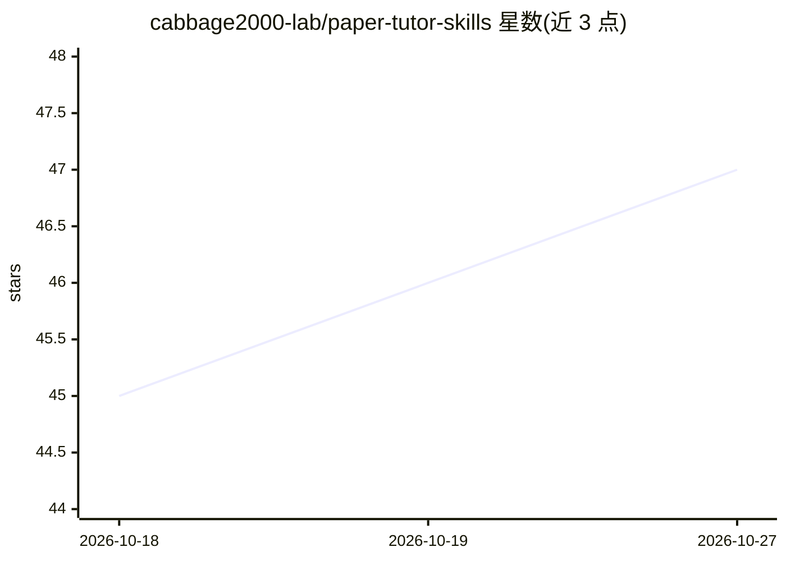

# cabbage2000-lab/paper-tutor-skills

⭐ 47 · Python · NOASSERTION · 推送 2026-10-10 · [GitHub](https://github.com/cabbage2000-lab/paper-tutor-skills) · 个人维护 · 中文 README

**面向中文研究生的学术辅导 skill 套件：选题到投稿全流程命令**

装进编程智能体（Claude Code / Codex / WorkBuddy）的学术辅导 skills 集合，当前 v0.1.8 含 25 个命令，覆盖选题、文献检索（中英双轨，英文接 arXiv/OpenAlex/Semantic Scholar/Crossref）、PRISMA 筛选、写作、引用六态核验（以真实 API 响应为准）、模拟评审与投稿出版链。明文不覆盖实验执行环节，不代写、不编数据、不做伦理豁免判断。安装方式为提示词引导克隆或插件命令，宿主为 Claude Code/Codex 等，采用 PolyForm Noncommercial 许可禁止商业使用。

## 筛选速览

| 维度 | 判定 | 备注 |
|---|---|---|
| AI 角色 | `ai-native` | 本体是模型或模型工具 |
| 许可风险 | `none` | NOASSERTION |
| 部署形态 | `None` |  |
| 模型依赖 | locked-api |  |
| 硬件要求 | — | 无带数字的原话,不猜 |
| 安装摩擦 | `low` | 无编译、无系统依赖或容器化 |
| 成熟度 | — | 结构信号不足 |

## 能力要点

- 25 个命令覆盖研究 5 阶段，基于 SKILL.md 标准跨宿主装载
- 引用核验六态结果以真实 API 响应为准，中文文献落人工核对
- 明文拒绝代写、编数据、降 AI 率、评审他人在审稿件等请求
- `.paper/` 留痕支持跨会话断点续跑与人机分工披露

## 适用场景

- 研究生自助搭建科研工作目录并走完选题到投稿流程
- 投稿前批量自查引用真实性与 GB/T 7714 格式
- 导师带学生做科研训练时记录人机分工留痕
- 生成投稿所需的 AI 使用披露说明

## 场景标签

`科研工具` `提示工程` · 领域:Agent 开发

## 证据(README 行号)

> L10: Paper-Tutor-Skills 是一套装进编程智能体（Claude Code / Codex / 国内 WorkBuddy）的学术辅导 skills，简体中文优先——AI 管效率（检索、整理、核对、结构化），人管研究决策（想
> L40: |**起步**|`/paper-init`|搭建标准科研工作目录（一轮提问就绪，顺带生成项目信息配置与可选的宿主配置文件）|✅ 已发布|
> L178: |"这些参考文献是真的吗" / "投稿前帮我自查一下引用" / "这条 DOI 能查到吗"|`/paper-verify`|逐条六态结果（已核实 / 元数据不符 / 已撤稿 / 未找到 / 无法核实 / 待人工核对），以真实 A

## 星数曲线

2026-10-18 45 → 2026-10-27 47（+2）

---
*卡片 v1 · prompt 1.4 · 生成 2026-10-25 · 置信度 high · 依据 README sha `21affd55261a` · [字段定义](../../DATASET.md)*
