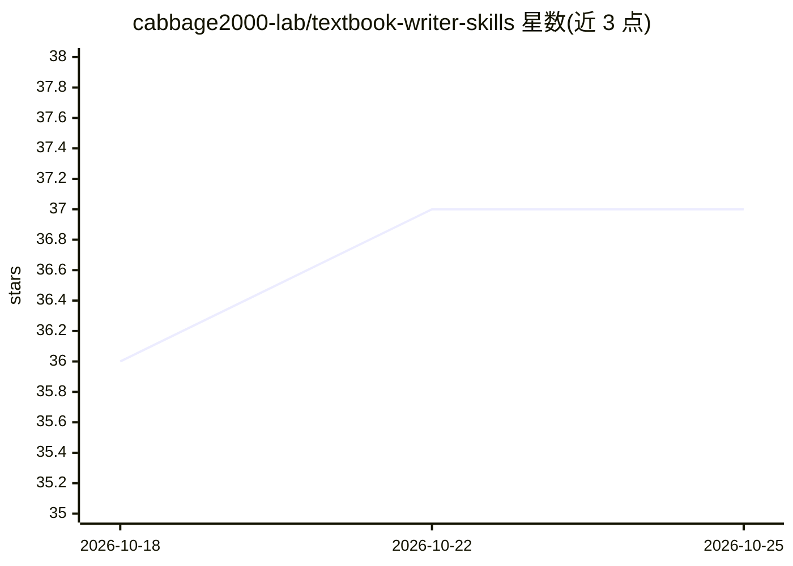

# cabbage2000-lab/textbook-writer-skills

⭐ 37 · Python · MIT · 推送 2026-10-19 · [GitHub](https://github.com/cabbage2000-lab/textbook-writer-skills) · [官网](https://github.com/cabbage2000-lab/textbook-writer-skills#readme) · 个人维护 · 中文 README

**装进编程智能体的教材写作 skill 组合，覆盖设计到定稿五阶段**

由 5 个 skill 组成的教材写作流水线，安装到 Claude Code / Codex / WorkBuddy 等编程智能体宿主中使用。按 UbD 逆向设计组织流程：教学定位 → UbD 五件套 gate → 章节树 gate → 四段式逐章写作 → 审核定稿，关键决策由作者在两处 gate 确认。学科差异通过可插拔学科档案实现（stem 真算复核 / humanities 核对来源 / economics 混合），验证不了的结论标注「需作者确认」；进度写入 .progress.json 支持断点续写。提供提示词粘贴安装、插件市场命令与 SkillHub 国内源三种安装途径。

## 筛选速览

| 维度 | 判定 | 备注 |
|---|---|---|
| AI 角色 | `ai-ecosystem` | LLM/agent 周边工具 |
| 许可风险 | `permissive` | MIT |
| 部署形态 | `None` |  |
| 模型依赖 | — | README 未给出锁定关系 |
| 硬件要求 | — | 无带数字的原话,不猜 |
| 安装摩擦 | `low` | 无编译、无系统依赖或容器化 |
| 成熟度 | — | 结构信号不足 |

## 能力要点

- 5 个 skill 覆盖从工作目录规划到审核定稿的五阶段流水线
- 可插拔学科档案：stem 真算复核、humanities 核对引文来源、economics 混合验证
- 两处 gate 停点要求作者确认 UbD 五件套与章节树，关键决策不由 AI 拍板
- 进度落盘 .progress.json，中断后从断点续写，已完成的章不重写

## 适用场景

- 把自己懂的课程知识写成有主线、有梯度、题目答案可信的成体系教材
- 基于已有讲义或 Word 素材规划整本教材或修订指定章节
- 按学科档案逐题验证答案，避免编造引文与算错例题

## 场景标签

`AI 写作` `提示工程` · 领域:Agent 开发

## 证据(README 行号)

> L11: Textbook-Writer-Skills 是一套装进编程智能体（Claude Code / Codex / 国内 WorkBuddy）的教材写作 skill 组合。它把成熟的教学设计方法装进 AI 的工作流：先想清楚「学生学完
> L107: |**0 · 起步**（可选）|`textbook-init`|一轮提问弄清写一本还是多本、放在哪里、要不要版本管理|工作目录骨架（可选 git 与 README 工作说明）|—|eval 6|

## 星数曲线

2026-10-18 36 → 2026-10-25 37（+1）

---
*卡片 v1 · prompt 1.4 · 生成 2026-10-25 · 置信度 high · 依据 README sha `c14ec9389e28` · [字段定义](../../DATASET.md)*
