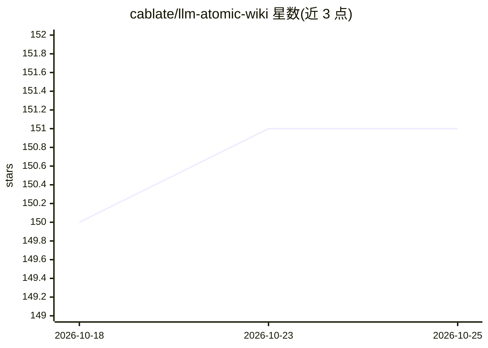

# cablate/llm-atomic-wiki

⭐ 151 · Shell · 推送 2026-04-20 · [GitHub](https://github.com/cablate/llm-atomic-wiki) · 个人维护 · 中文 README

**个人知识库编译框架：扩展 Karpathy LLM Wiki 模式**

在 Karpathy 的 raw→wiki 模式上增加四项扩展的框架仓库：原子层（一个 atom 一条声明，作为事实源）、主题分支组织、双层 Lint（程序化脚本先做确定性检查，LLM 再做语义检查）、并行编译命名锁。仓库只提供方法论、规范、脚本与目录结构，用户 fork 后放入自己的材料，用 Claude Code 等 LLM agent 驱动 Ingest→Compile→Index/Log→Lint→Query 流水线，产出 Markdown wiki。作者实际内容（584 帖→630 原子→83 页）保持私有。适用条件：200 页以内、知识相对稳定、单一所有者。

## 筛选速览

| 维度 | 判定 | 备注 |
|---|---|---|
| AI 角色 | `ai-ecosystem` | LLM/agent 周边工具 |
| 许可风险 | `none` | — |
| 部署形态 | `None` |  |
| 模型依赖 | — | README 未给出锁定关系 |
| 硬件要求 | — | 无带数字的原话,不猜 |
| 安装摩擦 | `low` | 无编译、无系统依赖或容器化 |
| 成熟度 | — | 结构信号不足 |

## 能力要点

- raw→atoms→wiki 两级编译，atoms 为事实源、wiki 为派生缓存
- 双层 Lint：lint.sh 程序化检查 + LLM 语义检查（矛盾/过期声明）
- gen-index/lint/log-append 三个 shell 脚本维护循环
- 作者以 584 帖、8,668 回复端到端运行验证（630 原子、83 wiki 页）

## 适用场景

- 把帖子和课程材料沉淀为可维护的个人知识 wiki
- fork 后用自己的材料运行 LLM 编译流水线
- 了解 compile-over-RAG 模式在个人知识管理中的实践条件

## 场景标签

`知识库管理` · 领域:知识与检索

## 证据(README 行号)

> L8: The repo gives you the framework — methodology, schema, scripts, folder structure. Fork it and run it on your own ma
> L80: 6. **Drive the pipeline with an LLM** — point Claude Code (or your agent) at `CLAUDE.md` and ask it to ingest a bat

## 星数曲线

2026-10-18 150 → 2026-10-25 151（+1）

---
*卡片 v1 · prompt 1.4 · 生成 2026-10-23 · 置信度 high · 依据 README sha `2377fee44280` · [字段定义](../../DATASET.md)*
