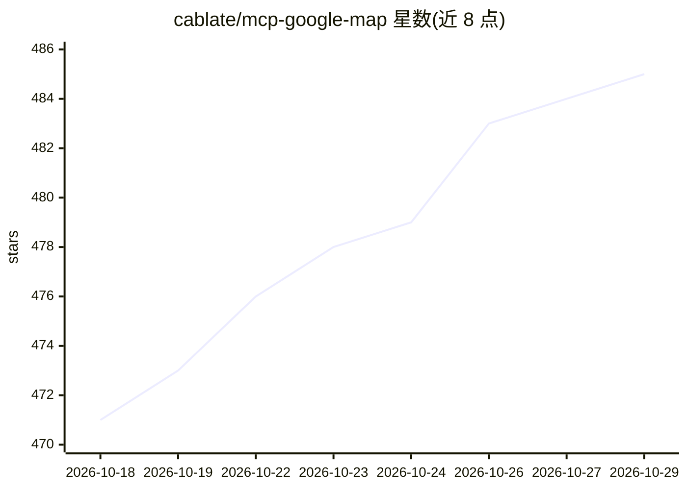

# cablate/mcp-google-map

⭐ 485 · TypeScript · MIT · 推送 2026-10-22 · [GitHub](https://github.com/cablate/mcp-google-map) · [官网](https://www.npmjs.com/package/@cablate/mcp-google-map) · 个人维护 · 中文 README

**面向 AI agent 的 Google Maps 工具集：18 个只读工具+3 个技能**

将 Google Maps Platform 封装为 18 个只读 agent 工具（地点搜索、路线、地理编码、天气、空气质量、本地 SEO 排名追踪等）与 3 个 Agent Skills，供 AI agent 通过 MCP（stdio/Streamable HTTP）、Codex/Claude Code 插件或独立 CLI 调用。工具支持按需注册白名单、HTTP 模式下的每会话 API key 隔离与 DNS 重绑定防护。运行需 Node.js 18+ 与启用了计费的 Google Cloud API key，实时调用可能产生费用；MIT 许可，可自托管。

## 筛选速览

| 维度 | 判定 | 备注 |
|---|---|---|
| AI 角色 | `ai-ecosystem` | LLM/agent 周边工具 |
| 许可风险 | `permissive` | MIT |
| 部署形态 | `library` | 以包/库形式分发 |
| 模型依赖 | — | README 未给出锁定关系 |
| 硬件要求 | — | 无带数字的原话,不猜 |
| 安装摩擦 | `low` | 无编译、无系统依赖或容器化 |
| 成熟度 | — | 结构信号不足 |

## 能力要点

- 18 个只读工具覆盖地点、路线、天气、空气质量与本地 SEO 网格排名
- 3 个按需加载的 Agent Skills：地图研究、行程规划、本地 SEO
- 同一能力可通过 MCP（stdio/HTTP）、插件或无状态 CLI 使用
- HTTP 模式支持每会话 API key 隔离与 DNS 重绑定防护

## 适用场景

- 让 Claude Code/Codex agent 查找真实地点并规划地理上可行的行程
- 脚本或自动化中批量地理编码与路线计算
- 通过网格排名与 SoLV 指标审计本地搜索可见性

## 场景标签

 · 领域:地理信息服务/AI agent 工具

## 证据(README 行号)

> L5: `@cablate/mcp-google-map` turns Google Maps Platform into 18 read-only agent tools and three focused Skills. An agen
> L7: You choose the integration model: Codex or Claude Code Plugin when you want Skills without MCP setup, stdio for desk
> L50: |**MCP stdio**|Claude Desktop, Cursor, VS Code, and other local MCP clients|The client starts a local MCP process|

## 星数曲线

2026-10-18 471 → 2026-10-29 485（+14）

---
*卡片 v1 · prompt 1.4 · 生成 2026-10-21 · 置信度 high · 依据 README sha `9fe42b905835` · [字段定义](../../DATASET.md)*
