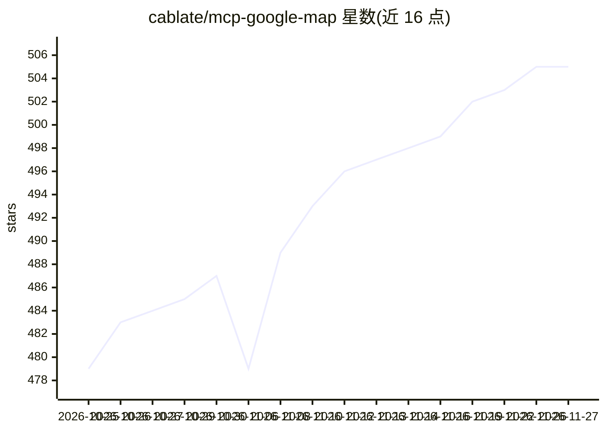

# cablate/mcp-google-map

⭐ 505 · TypeScript · MIT · 推送 2026-10-22 · [GitHub](https://github.com/cablate/mcp-google-map) · [官网](https://www.npmjs.com/package/@cablate/mcp-google-map) · 个人维护 · 中文 README

**为 AI agent 提供 Google Maps 位置查询与行程规划的 MCP 工具集**

将 Google Maps Platform 封装为 18 个只读 agent 工具与三个 Agent Skills，覆盖地点搜索、地理编码、路线、天气、空气质量与本地 SEO 排名追踪。支持多种接入方式：Codex 插件、Claude Code 插件（无需 MCP 配置）、独立 CLI（无状态命令返回 JSON）、MCP stdio 与 Streamable HTTP。HTTP 模式支持按会话隔离 API key 与 DNS rebinding 防护；可用环境变量按白名单裁剪工具列表。运行需 Node.js 22+ 与计费启用的 Google Cloud API key，调用可能产生费用。

## 筛选速览

| 维度 | 判定 | 备注 |
|---|---|---|
| AI 角色 | `ai-ecosystem` | LLM/agent 周边工具 |
| 许可风险 | `permissive` | MIT |
| 部署形态 | `library` | 以包/库形式分发 |
| 模型依赖 | — | README 未给出锁定关系 |
| 硬件要求 | — | 无带数字的原话,不猜 |
| 安装摩擦 | `low` | 无编译、无系统依赖或容器化 |
| 成熟度 | — | 结构信号不足 |

## 能力要点

- 18 个只读工具：搜索、地理编码、路线矩阵、多停靠点优化（最多 25 站）、静态地图
- 三种 Skills 按需加载：地图研究、行程规划、本地 SEO
- MCP 与独立 CLI 双形态，同一套工具
- HTTP 部署支持按会话 key 隔离与 DNS rebinding 防护

## 适用场景

- 让 AI agent 查询真实地点、营业时间并核对出行时间
- 生成经地理核验的多日行程与沿途停靠规划
- 以网格排名指标审计商户本地搜索可见性
- 批量地理编码富化地址数据

## 场景标签

 · 领域:AI agent 工具/位置服务

## 证据(README 行号)

> L5: `@cablate/mcp-google-map` turns Google Maps Platform into 18 read-only agent tools and three focused Skills. An agen
> L23: - **Use the same capabilities with or without MCP.** The standalone `exec` CLI works with Agent Skills and automati

## 星数曲线

2026-10-25 479 → 2026-11-27 505（+26）

---
*卡片 v1 · prompt 1.4 · 生成 2026-11-25 · 置信度 high · 依据 README sha `1d37fa062437` · [字段定义](../../DATASET.md)*
