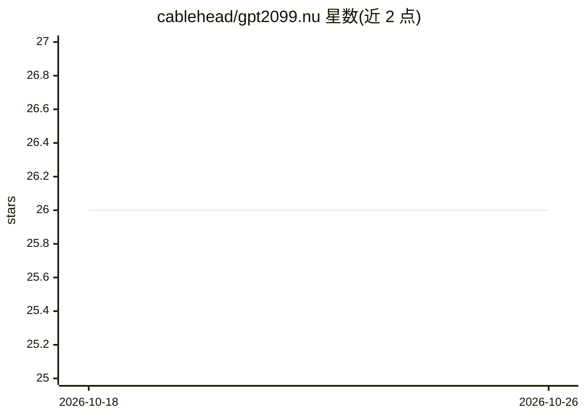

# cablehead/gpt2099.nu

⭐ 26 · Nushell · 推送 2026-03-17 · [GitHub](https://github.com/cablehead/gpt2099.nu) · [官网](https://cablehead.github.io/gpt2099.nu) · 个人维护

**Nushell 终端中可脚本化的 LLM 与 MCP 客户端**

以 Nushell 脚本/命令形式提供的 LLM 客户端：通过统一接口接入 Anthropic、Cerebras、Cohere、Gemini、OpenAI 等提供商，对话线程持久保存在 cross.stream 事件流中，用户可查看和编辑自身上下文窗口。支持连接 MCP 服务器扩展工具能力，可在对话中上传引用 PDF、图片与文本文件。安装依赖 cross.stream 生态，通过 overlay 加载、gpt init 初始化、gpt provider enable 配置 API key 后使用。面向希望在终端工作流中脚本化调用 LLM 的开发者。

## 筛选速览

| 维度 | 判定 | 备注 |
|---|---|---|
| AI 角色 | `ai-ecosystem` | LLM/agent 周边工具 |
| 许可风险 | `none` | — |
| 部署形态 | `None` |  |
| 模型依赖 | — | README 未给出锁定关系 |
| 硬件要求 | — | 无带数字的原话,不猜 |
| 安装摩擦 | `low` | 无编译、无系统依赖或容器化 |
| 成熟度 | — | 结构信号不足 |

## 能力要点

- 单一接口对接多家 LLM 提供商并可自行扩展
- 对话线程持久化且上下文窗口可查看、可编辑
- MCP 服务器接入扩展工具能力
- 对话中上传 PDF/图片/文本并自动识别内容类型

## 适用场景

- 在 Nushell 工作流中以管道方式调用 LLM
- 需要手动审查和编辑对话上下文的终端 AI 使用
- 通过 MCP 服务器为终端 LLM 会话扩展工具

## 场景标签

`模型网关` · 领域:Agent 开发

## 证据(README 行号)

> L8: A Nushell scriptable
> L9: MCP client
> L22: - **Flexible Tool Integration:** Connect to MCP servers to extend functionality. `gpt2099` already

## 星数曲线

2026-10-18 26 → 2026-10-26 26（+0）

---
*卡片 v1 · prompt 1.4 · 生成 2026-10-26 · 置信度 high · 依据 README sha `85f8663fe0fe` · [字段定义](../../DATASET.md)*
