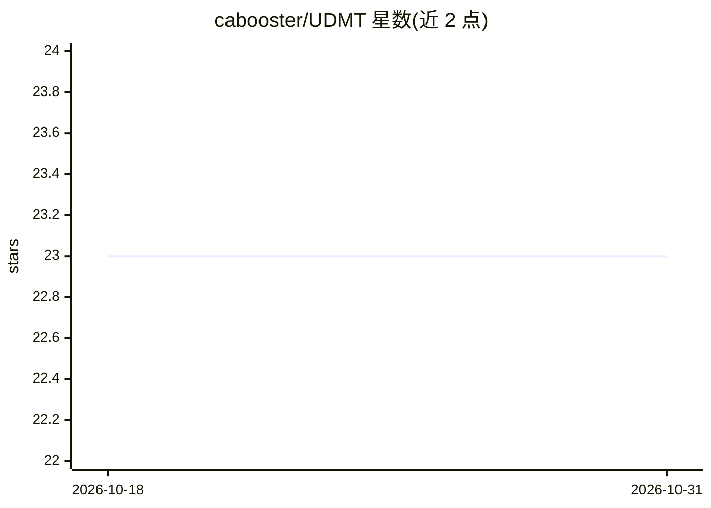

# cabooster/UDMT

⭐ 23 · Python · NOASSERTION · 推送 2026-09-08 · [GitHub](https://github.com/cabooster/UDMT) · [官网](https://cabooster.github.io/UDMT/) · 组织维护

**无标注多动物追踪工具：首帧点击即可训练追踪个体**

面向定量行为学与神经行为学的多动物追踪方法：用户仅在首帧点击各动物个体，系统以 SAM3 做点击分割与前向传播生成掩码，随后经无监督迁移学习训练网络，无需人工标注即完成追踪；在小鼠、大鼠、果蝇、线虫、斗鱼五类模式动物上验证。以 Python 源码与 GUI 提供，推荐 Linux + NVIDIA GPU + CUDA 12.6 环境，SAM3 权重需手动申请下载，Windows 安装不被推荐且配置较难。

## 筛选速览

| 维度 | 判定 | 备注 |
|---|---|---|
| AI 角色 | `ai-native` | 本体是模型或模型工具 |
| 许可风险 | `none` | NOASSERTION |
| 部署形态 | `library` | 以包/库形式分发 |
| 模型依赖 | — | README 未给出锁定关系 |
| 硬件要求 | — | 无带数字的原话,不猜 |
| 安装摩擦 | `high` | 编译与系统依赖俱全 |
| 成熟度 | — | 结构信号不足 |

## 能力要点

- 无需人工标注，仅首帧点击指定个体即可完成多动物追踪
- 集成 SAM3 做首帧点击分割与前向传播
- 提供 GUI 与演示视频（5 鼠/7 鼠）及对应预训练模型
- 其他预训练模型（trdimp/XMem 等）启动 GUI 前自动下载

## 适用场景

- 行为学实验中对同种外观相似、频繁交互的动物做多个体追踪
- 结合头戴微型显微镜记录与运动同步的钙信号分析
- 无标注条件下快速生成动物行为的量化轨迹数据

## 场景标签

 · 领域:计算行为学/计算机视觉

## 证据(README 行号)

> L23: Growing demands in quantitative ethology have motivated concerted efforts to develop high-accuracy and generalized 
> L25: We demonstrate the state-of-the-art performance of UDMT on five different kinds of model animals, including mice, r
> L148: We have released the Python source code and a user-friendly GUI of UDMT to make it an easily accessible tool for q

## 星数曲线

2026-10-18 23 → 2026-10-31 23（+0）

---
*卡片 v1 · prompt 1.4 · 生成 2026-10-27 · 置信度 mid · 依据 README sha `ab45dbbca834` · [字段定义](../../DATASET.md)*
