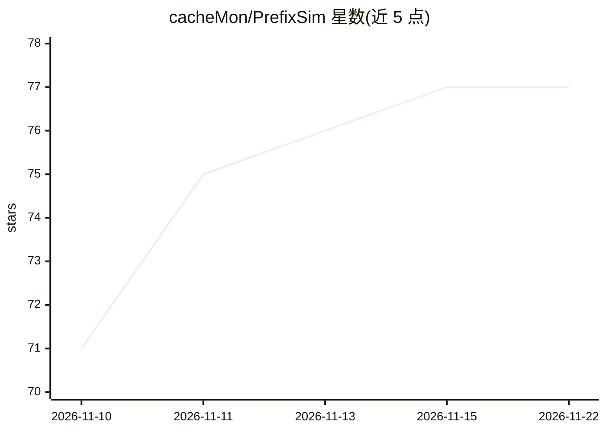

# cacheMon/PrefixSim

⭐ 77 · C++ · Apache-2.0 · 推送 2026-11-10 · [GitHub](https://github.com/cacheMon/PrefixSim) · [官网](https://libcachesim.com) · 组织维护

**LLM 推理前缀缓存的驱逐策略模拟器**

回放真实 LLM 请求 trace，模拟 KV-block 前缀缓存并比较驱逐策略：以节省的 prefill 计算量（compute saving ratio）而非块命中率作为指标。建模 serving 约束（请求整体验留、块 pin），基于 libCacheSim 提供 46 种驱逐策略（含计算感知与离线 oracle），支持 lcp 流式回放，附带两条生产 trace（freeinference/chutes）。需从源码编译构建，依赖 libCacheSim 及其系统依赖。

## 筛选速览

| 维度 | 判定 | 备注 |
|---|---|---|
| AI 角色 | `ai-ecosystem` | LLM/agent 周边工具 |
| 许可风险 | `permissive` | Apache-2.0 |
| 部署形态 | `None` |  |
| 模型依赖 | — | README 未给出锁定关系 |
| 硬件要求 | — | 无带数字的原话,不猜 |
| 安装摩擦 | `medium` | 含编译或系统依赖之一 |
| 成熟度 | — | 结构信号不足 |

## 能力要点

- 以 compute saving ratio（节省的 prefill 计算量）为主要指标比较策略
- 46 种驱逐策略，含计算感知、会话级与前缀树感知策略
- lcp 流式回放：656M 块访问的 LRU 运行需 105 s 与 146 MiB 内存
- 附带两条生产 trace（Qwen3-Coder-30B 分词、16-token 块）

## 适用场景

- 评估 LLM serving 引擎前缀缓存驱逐策略的实际计算节省
- 将自有 JSONL 请求 trace 转换并回放模拟
- 研究缓存容量与策略选择对 prefill 成本的影响

## 场景标签

`模型评测` · 领域:评测与运维

## 证据(README 行号)

> L7: **A fast simulator for the KV-block prefix cache of LLM serving engines.**
> L9: Engines such as vLLM and SGLang keep the KV cache of finished requests, so a new
> L64: PrefixSim builds on libCacheSim, which comes in as a submodule, and needs

## 星数曲线

2026-11-10 71 → 2026-11-22 77（+6）

---
*卡片 v1 · prompt 1.4 · 生成 2026-11-18 · 置信度 high · 依据 README sha `633a70d95166` · [字段定义](../../DATASET.md)*
