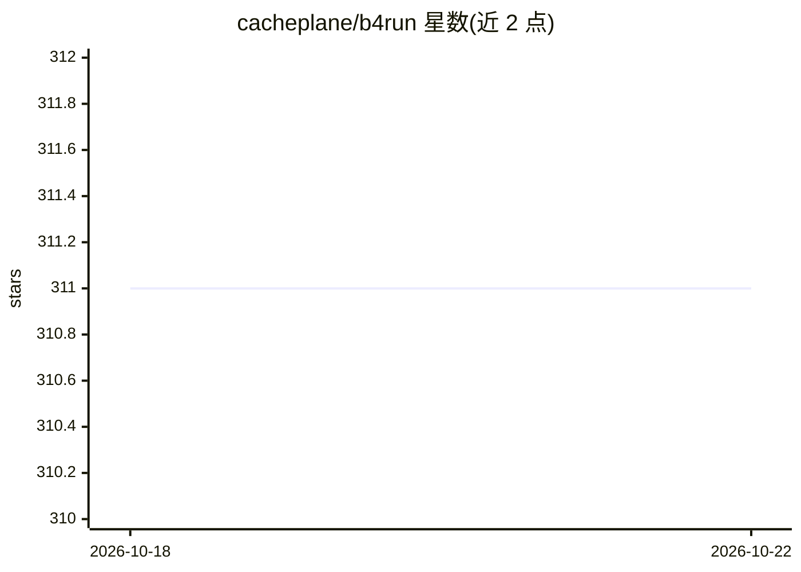

# cacheplane/b4run

⭐ 311 · TypeScript · MIT · 推送 2026-10-21 · [GitHub](https://github.com/cacheplane/b4run) · [官网](https://b4.run) · 个人维护

**给 TypeScript 开发者的 LangGraph.js Agent 应用框架**

B4.run 是基于 LangGraph.js 的 TypeScript Agent 框架：以文件系统路由组织 agent/workflow/graph/chain 入口，在构建期生成 TypeScript 路由、参数、状态与工具类型声明；提供 SQLite 持久化、沙箱执行、工具审批（tools.approve/tools.deny）与权限门控。测试采用 fixture 回放的确定性循环，无需 API key。默认构建产出 Node 服务器、Dockerfile 与 LangSmith 图产物，不负责基础设施供应与托管。要求 Node.js 24+，pre-1.0 阶段 API 变动中。

## 筛选速览

| 维度 | 判定 | 备注 |
|---|---|---|
| AI 角色 | `ai-ecosystem` | LLM/agent 周边工具 |
| 许可风险 | `permissive` | MIT |
| 部署形态 | `self-host` | docker 或自建部署 |
| 模型依赖 | local-ok | 支持本地模型 |
| 硬件要求 | — | 无带数字的原话,不猜 |
| 安装摩擦 | `low` | 无编译、无系统依赖或容器化 |
| 成熟度 | `idea` | |

## 能力要点

- 文件系统路由 + 构建期生成 TypeScript 类型声明
- 工具审批机制与沙箱隔离、shell 命令与文件路径权限门控
- fixture 回放的确定性测试循环，无需 API key
- 默认构建产出 Node 服务器、Dockerfile 与 LangSmith 图产物

## 适用场景

- TypeScript 团队以文件路由方式开发 LangGraph.js Agent 应用
- 需要人工审批门控的工具调用（如飞行计划提交）
- 离线确定性测试 Agent 交互

## 场景标签

`Agent 框架` · 领域:Agent 开发

## 证据(README 行号)

> L3:  An agent framework, the way I'd build it.
> L8: B4.run adds file-system routes, generated types, workspaces, sandbox execution,
> L91: |**B4.run**|Supplies file-system routing, generated types, local test and development conventions, persistence prim

## 星数曲线

2026-10-18 311 → 2026-10-22 311（+0）

---
*卡片 v1 · prompt 1.4 · 生成 2026-10-21 · 置信度 mid · 依据 README sha `538dc2f613f7` · [字段定义](../../DATASET.md)*
