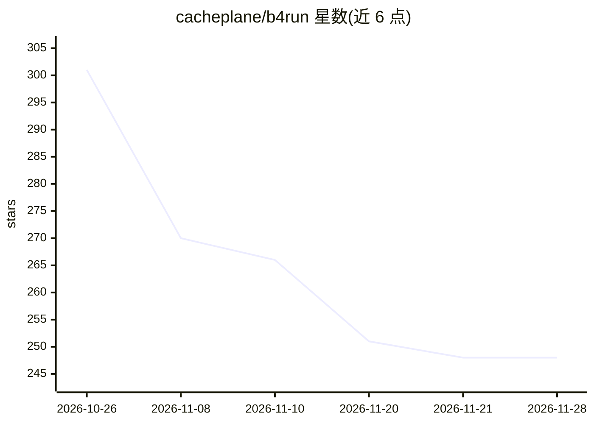

# cacheplane/b4run

⭐ 248 · TypeScript · MIT · 推送 2026-11-19 · [GitHub](https://github.com/cacheplane/b4run) · [官网](https://b4.run) · 个人维护

**给 TypeScript 团队在 LangGraph.js 上提供约定式 agent 框架**

围绕 LangGraph.js 的 TypeScript 元框架：提供文件系统路由、生成类型、工作区、沙箱执行、审批门控与 SQLite 持久化等应用层约定，内置 agent() 基于 LangChain 集成。用户保持原有 LangGraph.js 图与导入，可经 graph 路由增量迁移。默认构建产出可运行 Node 服务器、Dockerfile 与 LangSmith 图工件，不负责基础设施供给、托管或密钥管理。要求 Node.js 24+ 与 npm 11，当前处于 pre-1.0，API 面变动中。

## 筛选速览

| 维度 | 判定 | 备注 |
|---|---|---|
| AI 角色 | `ai-ecosystem` | LLM/agent 周边工具 |
| 许可风险 | `permissive` | MIT |
| 部署形态 | `self-host` | docker 或自建部署 |
| 模型依赖 | local-ok | 支持本地模型 |
| 硬件要求 | — | 无带数字的原话,不猜 |
| 安装摩擦 | `low` | 无编译、无系统依赖或容器化 |
| 成熟度 | `idea` | |

## 能力要点

- 文件系统路由与类型生成，agent 写为单个路由文件
- tools.deny 与 tools.approve 实现工具限制与人工审批
- fixture 回放测试离线运行，无 API key、无模型调用
- 默认构建产出 Node 服务器、Dockerfile 与 LangSmith 工件

## 适用场景

- TypeScript 团队用 LangGraph.js 构建带文件路由的 agent 应用
- 从既有 LangGraph.js 图增量迁移到框架约定
- 用审批门控限制 agent 的工具调用与文件访问
- 通过 coding agent 读取框架参考后生成路由代码

## 场景标签

`Agent 框架` · 领域:Agent 开发

## 证据(README 行号)

> L3:  An agent framework, the way I'd build it.
> L89: |**LangChain**|Remains available. B4.run's built-in `agent()` uses LangChain integrations; raw graph and chain rout
> L90: |**LangGraph.js**|The graph runtime, required by B4.run. B4.run adds application conventions around it rather than 

## 星数曲线

2026-10-26 301 → 2026-11-28 248（-53）

---
*卡片 v1 · prompt 1.4 · 生成 2026-11-25 · 置信度 mid · 依据 README sha `72b5fcdabf74` · [字段定义](../../DATASET.md)*
