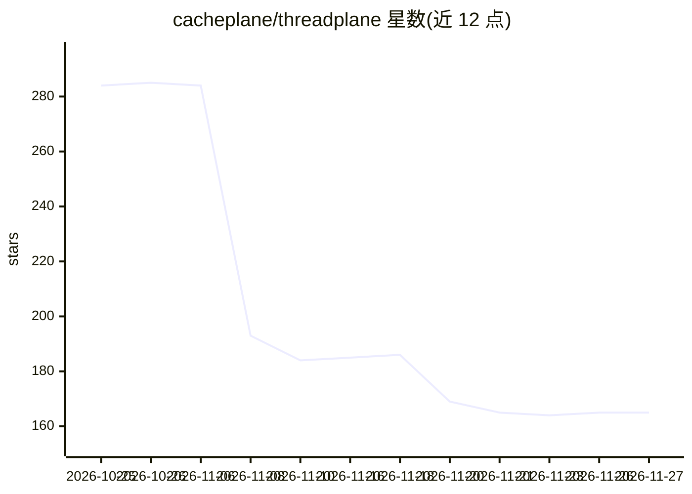

# cacheplane/threadplane

⭐ 165 · TypeScript · MIT · 推送 2026-11-22 · [GitHub](https://github.com/cacheplane/threadplane) · [官网](https://threadplane.ai) · 组织维护

**给 Angular 开发者构建 agent 聊天界面的开源线程层**

面向 Angular 20–22 的开源 agent 线程层 npm 包：提供聊天界面、持久化线程、人工审批（interrupts）、工具进度、子 agent 与生成式 UI。核心机制是把 LangGraph 或 AG-UI 后端适配为运行时无关的 `Agent` 契约，通过 `provideAgent()`/`injectAgent()` 以 Angular Signals 暴露流式状态，组件与传输层可通过 `MockAgentTransport` 替换以便测试。React 支持为私有源码构建的实验性预览。MIT 许可，无账号、无云端依赖。

## 筛选速览

| 维度 | 判定 | 备注 |
|---|---|---|
| AI 角色 | `ai-ecosystem` | LLM/agent 周边工具 |
| 许可风险 | `permissive` | MIT |
| 部署形态 | `library` | 以包/库形式分发 |
| 模型依赖 | — | README 未给出锁定关系 |
| 硬件要求 | — | 无带数字的原话,不猜 |
| 安装摩擦 | `low` | 无编译、无系统依赖或容器化 |
| 成熟度 | — | 结构信号不足 |

## 能力要点

- 将 LangGraph / AG-UI 后端适配为运行时无关的 `Agent` 契约
- 以 Angular Signals 暴露 messages/status/interrupt/toolCalls 等状态
- 注册表制生成式 UI，渲染限制在自有设计系统组件内
- 提供无后端 fake agent 用于先行构建与测试 UI

## 适用场景

- 为 LangGraph agent 搭建 Angular 聊天与审批界面
- 接入任意 AG-UI 兼容端点复用同一套聊天组件
- 在自有设计系统中渲染 agent 生成的界面组件

## 场景标签

`Agent 框架` · 领域:Agent 开发

## 证据(README 行号)

> L28: **Threadplane is the open-source thread-plane for Angular agents.** Chat, durable
> L31: where it is: Threadplane adapts a LangGraph or AG-UI agent into a runtime-neutral
> L165: The runtime-neutral `Agent` contract is the stability boundary between adapters

## 星数曲线

2026-10-25 284 → 2026-11-27 165（-119）

---
*卡片 v1 · prompt 1.4 · 生成 2026-11-27 · 置信度 high · 依据 README sha `39dbd6d0ea1d` · [字段定义](../../DATASET.md)*
