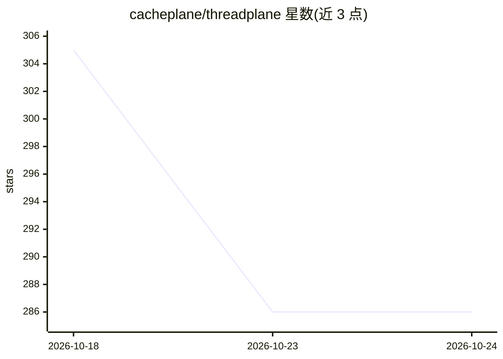

# cacheplane/threadplane

⭐ 284 · TypeScript · MIT · 推送 2026-10-24 · [GitHub](https://github.com/cacheplane/threadplane) · [官网](https://threadplane.ai) · 组织维护

**面向 Angular 的开源 agent 线程层：聊天、持久线程与生成式 UI**

为 Angular 20–22 提供 agent 聊天界面的 TypeScript 库族：将 LangGraph 或 AG-UI 后端适配为运行时无关的 Agent 契约，以 Angular Signals 暴露消息、状态、中断、工具进度、子 agent 等能力；支持持久线程、人工审批与通过组件注册表渲染的生成式 UI。提供 fake agent 供无后端开发与测试，包含 8 个 MIT 协议的 npm 包。React 预览为私有源码构建。

## 筛选速览

| 维度 | 判定 | 备注 |
|---|---|---|
| AI 角色 | `ai-ecosystem` | LLM/agent 周边工具 |
| 许可风险 | `permissive` | MIT |
| 部署形态 | `library` | 以包/库形式分发 |
| 模型依赖 | — | README 未给出锁定关系 |
| 硬件要求 | — | 无带数字的原话,不猜 |
| 安装摩擦 | `low` | 无编译、无系统依赖或容器化 |
| 成熟度 | — | 结构信号不足 |

## 能力要点

- 将 LangGraph / AG-UI 后端适配为运行时无关的 Agent 契约
- 以 Angular Signals 暴露消息、中断、工具进度、子 agent、线程切换
- 生成式 UI 通过用户自有组件注册表渲染
- fake agent 支持无后端、无 API key 的开发与测试

## 适用场景

- 为 LangGraph 或 AG-UI agent 搭建 Angular 聊天界面
- 在 agent 应用中实现人工审批与中断流程
- 让 agent 在既有设计系统组件内渲染生成式 UI

## 场景标签

`Agent 框架` · 领域:Agent 开发

## 证据(README 行号)

> L28: **Threadplane is the open-source thread-plane for Angular agents.** Chat, durable
> L31: where it is: Threadplane adapts a LangGraph or AG-UI agent into a runtime-neutral
> L129: |`@threadplane/langgraph`|LangGraph adapter; `provideAgent()` / `injectAgent()` expose a LangGraph run as Angular 

## 星数曲线

2026-10-18 305 → 2026-10-24 286（-19）

---
*卡片 v1 · prompt 1.4 · 生成 2026-10-21 · 置信度 high · 依据 README sha `947ec5e757e2` · [字段定义](../../DATASET.md)*
