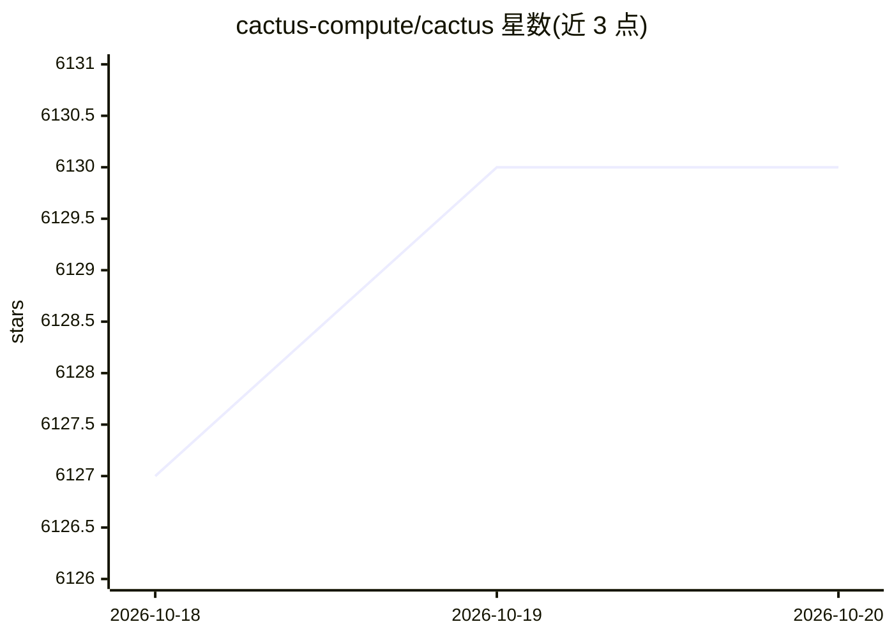

# cactus-compute/cactus

⭐ 6,130 · C++ · NOASSERTION · 推送 2026-09-26 · [GitHub](https://github.com/cactus-compute/cactus) · [官网](https://cactuscompute.com) · 组织维护

**面向手机与可穿戴设备的本地 LLM/VLM 推理引擎**

Cactus 是面向移动设备与可穿戴设备的端侧 AI 推理引擎，以 C/C++ 实现分层组件：Engine 层提供 OpenAI 兼容的文本、语音、视觉接口（补全、流式、工具调用、转录、嵌入、RAG、向量索引），Graph 层为张量算子，Kernels 层提供 ARM NEON SIMD 内核，Quants 层支持 4-bit 到 1-bit 旋转码本量化，Hybrid 层可按本地置信度将难题路由到云端。提供 Python 包与 CLI，及 Swift/Kotlin/Flutter/React Native/Python/Rust 绑定；附 Needle 26m 参数端上工具调用模型。README 给出多设备推理速度与量化精度基准表。

## 筛选速览

| 维度 | 判定 | 备注 |
|---|---|---|
| AI 角色 | `ai-ecosystem` | LLM/agent 周边工具 |
| 许可风险 | `none` | NOASSERTION |
| 部署形态 | `None` |  |
| 模型依赖 | — | README 未给出锁定关系 |
| 硬件要求 | — | 无带数字的原话,不猜 |
| 安装摩擦 | `low` | 无编译、无系统依赖或容器化 |
| 成熟度 | `idea` | |

## 能力要点

- OpenAI 兼容 API：文本/语音/视觉，含工具调用、转录、嵌入、RAG
- ARM NEON SIMD 内核与 4-bit 至 1-bit 旋转码本量化
- 按本地模型置信度自动将困难查询路由到云端的 Hybrid 机制
- Swift/Kotlin/Flutter/React Native/Python/Rust 六种绑定

## 适用场景

- 在手机、手表等设备上离线运行 LLM/VLM 推理
- 通过 CLI 一键下载/转换 HuggingFace 模型并运行
- 端侧工具调用（Needle 模型）与云端兜底的混合推理

## 场景标签

`推理引擎` `模型量化` · 领域:训练与推理

## 证据(README 行号)

> L12: A hybrid edge-cloud AI engine for mobile devices & wearables.
> L116: |Cactus Engine|C|Chat completion, streaming, tool calling, transcription, embeddings, RAG, vision, vector index, c

## 星数曲线

2026-10-18 6,127 → 2026-10-20 6,130（+3）

---
*卡片 v1 · prompt 1.4 · 生成 2026-10-20 · 置信度 high · 依据 README sha `dc2539ed1436` · [字段定义](../../DATASET.md)*
