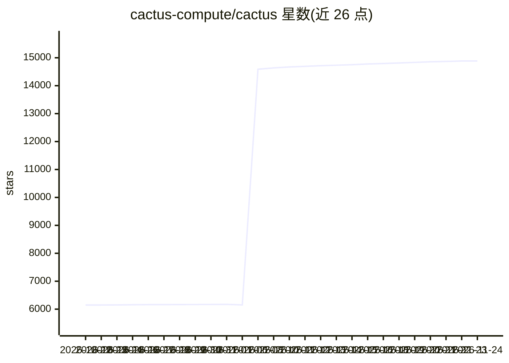

# cactus-compute/cactus

⭐ 14,898 · Python · Apache-2.0 · 推送 2026-11-23 · [GitHub](https://github.com/cactus-compute/cactus) · [官网](https://cactuscompute.com) · 组织维护

**消费级设备上的本地文本/语音/视觉模型运行库**

单个 Python 包提供在消费设备本地运行文本、语音与视觉模型的能力：Needle 支持工具调用与结构化数据抽取和文本嵌入，Whistle 对七种语言语音转录并输出词级时间戳，Mirage 描述图像并抽取结构化数据，另支持模型微调。引擎与模型权重首次使用时下载缓存，推理本地运行且不依赖 JAX。提供 Python API 与 CLI；Mac 上 Apple silicon 可通过 cactus-mlx 运行 CQ 检查点并启动 OpenAI 兼容 API。Python 3.9+。

## 筛选速览

| 维度 | 判定 | 备注 |
|---|---|---|
| AI 角色 | `ai-ecosystem` | LLM/agent 周边工具 |
| 许可风险 | `permissive` | Apache-2.0 |
| 部署形态 | `library` | 以包/库形式分发 |
| 模型依赖 | — | README 未给出锁定关系 |
| 硬件要求 | — | 无带数字的原话,不猜 |
| 安装摩擦 | `low` | 无编译、无系统依赖或容器化 |
| 成熟度 | — | 结构信号不足 |

## 能力要点

- Needle 工具调用、结构化抽取与文本嵌入
- Whistle 七语言语音转录，含词级时间戳
- Mirage 图像描述与结构化数据抽取
- cactus-mlx 在 Apple silicon 上运行 CQ 检查点并提供 OpenAI 兼容 API

## 适用场景

- 在手机/PC 等消费设备上本地运行 LLM、语音与视觉推理
- 为本地 Agent 添加工具调用能力
- 离线语音转录与图像理解
- 用 cactus-compute[train] 微调 Needle 或 Whistle

## 场景标签

`推理引擎` `微调` `语音识别` · 领域:感知与多模态

## 证据(README 行号)

> L3: Run text, speech and vision models locally with one Python package. Cactus provides tool calling, structured extract
> L50: Run CQ checkpoints with the `cactus-mlx` command, included in this package.

## 星数曲线

2026-10-22 6,147 → 2026-11-24 14,885（+8,738）

---
*卡片 v1 · prompt 1.4 · 生成 2026-11-22 · 置信度 high · 依据 README sha `b9aceb773b1b` · [字段定义](../../DATASET.md)*
