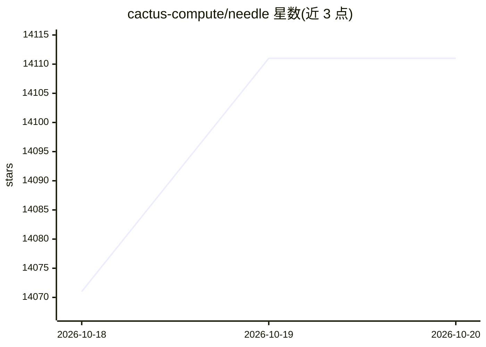

# cactus-compute/needle

⭐ 14,111 · Python · Apache-2.0 · 推送 2026-10-19 · [GitHub](https://github.com/cactus-compute/needle) · [官网](https://cactuscompute.com) · 组织维护

**面向小型设备的端侧自动化基础模型（8-29 MB）**

Cactus Compute 团队构建的基础模型，单一二进制文件 8-29 MB，为手机、可穿戴、智能家居、机器人、汽车和微控制器提供端侧能力：根据应用暴露的函数生成工具调用并填充参数、按声明结构抽取类型化字段、句子级文本嵌入，配套 16.9 MB 的 Whistle 语音转文字模型共享同一引擎。支持 2-bit 量化的 .cact 容器格式，可通过 LoRA 或平台微调裁剪到 2 层子网络部署到更小设备。权衡说明：模型以牺牲通用对话能力换取工具调用表现。默认开启遥测，可用环境变量关闭。

## 筛选速览

| 维度 | 判定 | 备注 |
|---|---|---|
| AI 角色 | `ai-native` | 本体是模型或模型工具 |
| 许可风险 | `permissive` | Apache-2.0 |
| 部署形态 | `desktop` | 安装包/桌面程序 |
| 模型依赖 | — | README 未给出锁定关系 |
| 硬件要求 | — | 无带数字的原话,不猜 |
| 安装摩擦 | `medium` | 含编译或系统依赖之一 |
| 成熟度 | — | 结构信号不足 |

## 动量与使用信号

- 维护:`active` — 距上次 push 0.7 天,年发版 0,35 位贡献者
- 涨星:近 1 天 **+41**(自 20261016 起算)
- 安装:pypi 包 `cactus-needle` 月下载 20,411

## 能力要点

- 工具调用：从用户话语生成函数调用并填充参数，无覆盖时返回空列表
- 结构化抽取：由 schema 编译的字节级语法约束解码，保证输出可解析
- Whistle 语音模型与 Needle 共享 .cact 容器与 C++ 引擎，音频入、工具调用出
- 本地（JAX CPU/CUDA/Metal）与平台两种微调路径，子网络最小可至 2 层

## 适用场景

- 为手机/可穿戴/微控制器上的应用添加离线工具调用
- 在设备本地做结构化抽取与文本嵌入检索
- 麦克风常开的设备需要离线语音输入并触发动作

## 场景标签

`微调` `模型量化` `语音识别` · 领域:感知与多模态

## 证据(README 行号)

> L3: A foundation model for mobiles, wearables, robots, smart home, automotive and microcontrollers. The whole model is a
> L164: Needle is built by the Cactus Compute team. If you use it in your work, please cite:

## 星数曲线

2026-10-18 14,071 → 2026-10-20 14,111（+40）

---
*卡片 v1 · prompt 1.4 · 生成 2026-10-18 · 置信度 high · 依据 README sha `f25bdbe8a640` · [字段定义](../../DATASET.md)*
