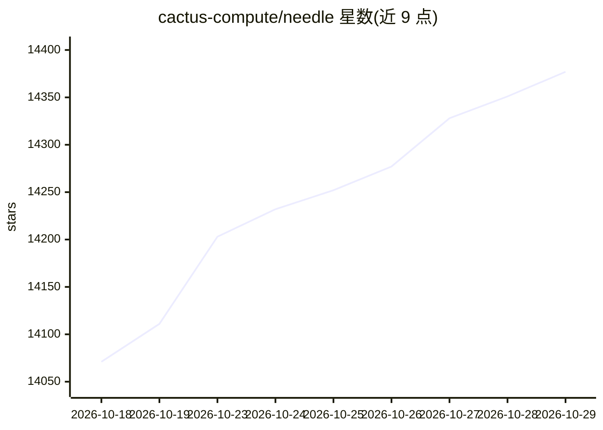

# cactus-compute/needle

⭐ 14,377 · Python · Apache-2.0 · 推送 2026-10-19 · [GitHub](https://github.com/cactus-compute/needle) · [官网](https://cactuscompute.com) · 组织维护

**面向手机/可穿戴/微控制器等小型设备的端侧基础模型**

Cactus Compute 团队开发的自动化基础模型 Needle：单一 8-29 MB 二进制，提供工具调用（自动选函数并填充参数）、结构化提取（语法约束保证输出可解析）、文本嵌入与语音输入；配套语音转文本模型 Whistle（16.9 MB，7 种语言，共享同一引擎与容器）。支持 LoRA 本地微调与平台微调两种方式，按平台分发预构建引擎（macOS/Linux ARM 等），默认开启遥测、可经环境变量关闭。

## 筛选速览

| 维度 | 判定 | 备注 |
|---|---|---|
| AI 角色 | `ai-native` | 本体是模型或模型工具 |
| 许可风险 | `permissive` | Apache-2.0 |
| 部署形态 | `desktop` | 安装包/桌面程序 |
| 模型依赖 | — | README 未给出锁定关系 |
| 硬件要求 | — | 无带数字的原话,不猜 |
| 安装摩擦 | `medium` | 含编译或系统依赖之一 |
| 成熟度 | — | 结构信号不足 |

## 动量与使用信号

- 维护:`active` — 距上次 push 0.7 天,年发版 0,35 位贡献者
- 涨星:近 1 天 **+41**(自 20261016 起算)
- 安装:pypi 包 `cactus-needle` 月下载 20,411

## 能力要点

- 工具调用返回 function_calls 与校准 confidence，未覆盖请求返回空列表
- Whistle 语音转文本与 Needle 共享 .cact 容器与 C++ 引擎，音频输入直接产出工具调用
- 阶梯式子网络：2-20 层均为可部署模型，按层微调适配更小设备
- 按平台提供预构建引擎（macos-arm64、linux-arm64 等），CLI 一键构建

## 适用场景

- 在手机、可穿戴、智能家居等设备上离线完成工具调用与结构化提取
- App 内本地语音输入并直接触发函数调用
- 针对自家产品工具集微调小模型后部署到边缘设备

## 场景标签

`微调` `语音识别` `推理引擎` · 领域:感知与多模态

## 证据(README 行号)

> L3: A foundation model for mobiles, wearables, robots, smart home, automotive and microcontrollers. The whole model is a
> L5: - **Tool calls**: given the functions your app exposes, Needle picks the right ones and fills every argument from wh
> L8: - **Speech**: Whistle, our speech-to-text model, shares Needle's container and engine. One build gives Needle audio 

## 星数曲线

2026-10-18 14,071 → 2026-10-29 14,377（+306）

---
*卡片 v1 · prompt 1.4 · 生成 2026-10-20 · 置信度 high · 依据 README sha `dac2a1624e07` · [字段定义](../../DATASET.md)*
