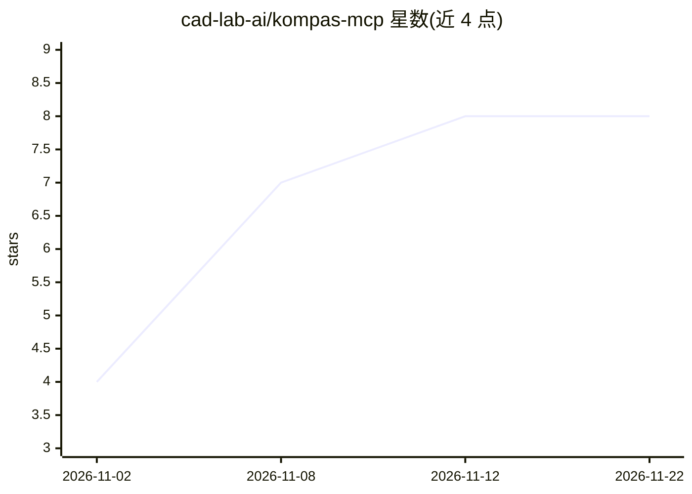

# cad-lab-ai/kompas-mcp

⭐ 8 · NOASSERTION · 推送 2026-11-09 · [GitHub](https://github.com/cad-lab-ai/kompas-mcp) · [官网](https://cad-lab.xyz) · 组织维护

**让 MCP 代理在已打开的 KOMPAS-3D 模型中设计与修改零件的连接器**

面向 KOMPAS-3D 的 MCP 服务器：将 Claude、Codex、Cursor 等支持 MCP 的代理接入用户已打开的 KOMPAS 模型，代理可按阶段构建和修改零件与装配、读取图纸与明细表、检查间隙、生成剖切与视图快照并以数字汇报。机制上按阶段提交修改（一次 Ctrl+Z 可撤销）、提交前自动校验重建错误与用户条件、用户编辑时强制关闭代理阶段以避免冲突。以安装包发布，本地运行，数据不经服务器外发；源码暂未公开。

## 筛选速览

| 维度 | 判定 | 备注 |
|---|---|---|
| AI 角色 | `ai-ecosystem` | LLM/agent 周边工具 |
| 许可风险 | `none` | NOASSERTION |
| 部署形态 | `desktop` | 安装包/桌面程序 |
| 模型依赖 | — | README 未给出锁定关系 |
| 硬件要求 | — | 无带数字的原话,不猜 |
| 安装摩擦 | `low` | 无编译、无系统依赖或容器化 |
| 成熟度 | `idea` | |

## 能力要点

- 按阶段编辑：每阶段对应一条撤销记录，可一键 Ctrl+Z 回退
- 阶段关闭前自动校验重建错误、干涉与用户条件并输出数值报告
- 安装器自动向 Claude Code、Codex、Cursor、VS Code 等 8 类代理注册 MCP 服务器并写入 kompas-engineering 技能
- 导出支持 STEP/IGES/STL 与 PDF/DXF/PNG

## 适用场景

- 用自然语言让代理在 KOMPAS 中设计法兰、轴等零件并输出工程文档
- 让代理检查装配间隙、图纸标注缺失等问题并给出数值
- 对已有模型做参数修改（如增大中心距）并查看影响

## 场景标签

 · 领域:CAD/工程设计

## 证据(README 行号)

> L3: MCP-сервер для КОМПАС-3D. Подключает Claude, Codex, Cursor и любого другого агента с поддержкой MCP к
> L87:  регистрирует MCP-сервер `kompas` во всех найденных на машине агентах (их остальные настройки не трогает) и
> L141: |правка этапами|`change_begin` → `code_exec` → `change_end`; `change_abort`, `change_undo`, `change_status`, `hist

## 星数曲线

2026-11-02 4 → 2026-11-22 8（+4）

---
*卡片 v1 · prompt 1.4 · 生成 2026-11-20 · 置信度 high · 依据 README sha `11be7ba5c31b` · [字段定义](../../DATASET.md)*
