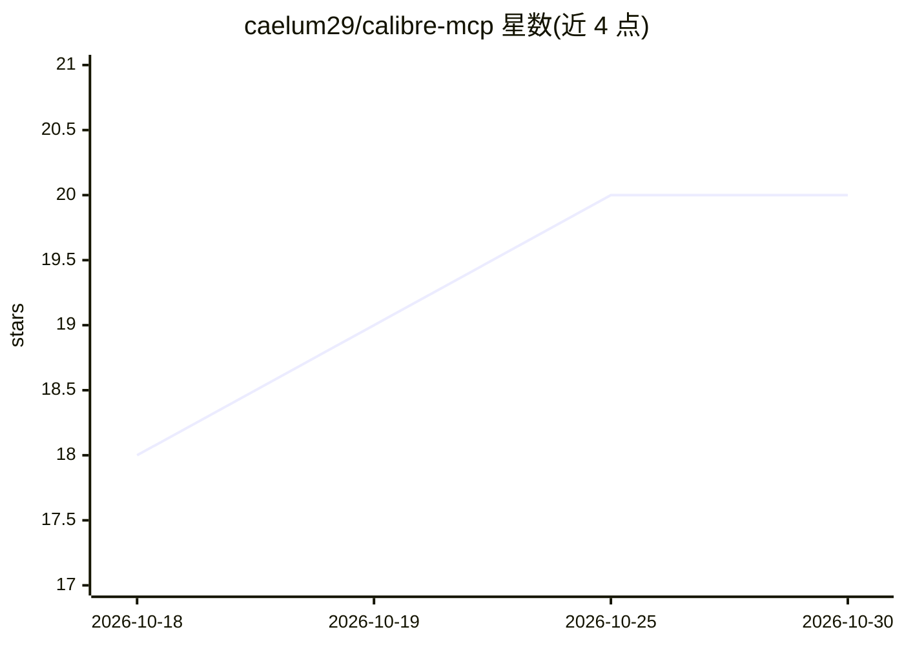

# caelum29/calibre-mcp

⭐ 20 · TypeScript · MIT · 推送 2026-10-28 · [GitHub](https://github.com/caelum29/calibre-mcp) · [官网](https://www.npmjs.com/package/calibre-mcp) · 个人维护

**把 Calibre 电子书库接入 AI 客户端的 MCP 服务器，含语义检索**

面向 Claude Desktop / Claude Code 等任意 MCP 客户端的 Calibre 书库连接器：提供 19 个工具覆盖检索、读内容、浏览分类与可选的元数据编辑、去重合并、导入删除；写入默认关闭，需 MCP 侧与 Calibre Content Server 侧双重开关开启，破坏性操作先预览再确认。语义检索为可选功能：通过 @huggingface/transformers 加载 multilingual-e5-small 与 cross-encoder 重排模型，混合向量+关键词检索，支持跨语言查询；无模型时可退化为纯关键词索引。支持 Claude Desktop 内嵌 3D 封面流等 MCP Apps UI。需本机运行 Calibre 及 Content Server。

## 筛选速览

| 维度 | 判定 | 备注 |
|---|---|---|
| AI 角色 | `ai-ecosystem` | LLM/agent 周边工具 |
| 许可风险 | `permissive` | MIT |
| 部署形态 | `library` | 以包/库形式分发 |
| 模型依赖 | — | README 未给出锁定关系 |
| 硬件要求 | — | 无带数字的原话,不猜 |
| 安装摩擦 | `low` | 无编译、无系统依赖或容器化 |
| 成熟度 | — | 结构信号不足 |

## 能力要点

- 19 个工具覆盖书库读写（写入默认关闭、双重开关+预览确认）
- 可选语义检索：multilingual-e5-small 嵌入 + 交叉编码器重排的混合检索，支持 EN⇄RU 跨语言
- 经 Open Library / Google Books 为原始文件名书籍恢复元数据
- Claude Desktop 中渲染封面轮播、书籍卡片与图片查看器（MCP Apps）

## 适用场景

- 用自然语言在自己的电子书库里按含义找书或找某本书里的段落
- 让 AI 助手批量整理书库元数据、去重合并
- 审计书库质量（缺失元数据、无效 ISBN）

## 场景标签

`语义搜索` `知识库管理` · 领域:知识与检索

## 证据(README 行号)

> L11: > **The most capable Calibre MCP server in existence** — connect Claude (or any MCP client)
> L25: - ** 19 tools** covering the full surface: search, read content, browse categories, curate,
> L28: - **Semantic search** — meaning-based, hybrid vector + keyword retrieval over your whole

## 星数曲线

2026-10-18 18 → 2026-10-30 20（+2）

---
*卡片 v1 · prompt 1.4 · 生成 2026-10-28 · 置信度 mid · 依据 README sha `6bb856daa608` · [字段定义](../../DATASET.md)*
