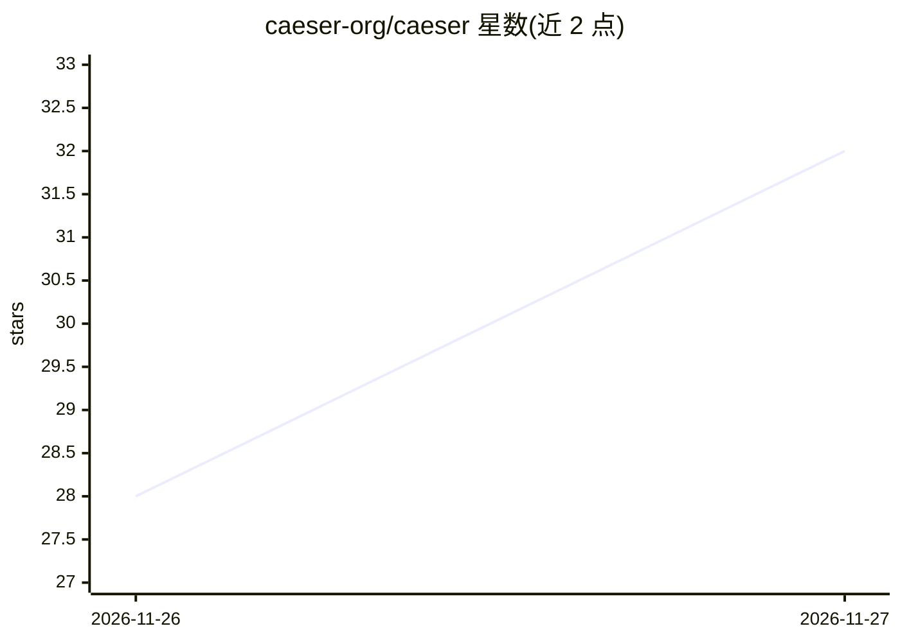

# caeser-org/caeser

⭐ 32 · Go · NOASSERTION · 推送 2026-11-26 · [GitHub](https://github.com/caeser-org/caeser) · [官网](caeser.yaxh.tech) · 组织维护

**为 Go 开发者将 CI 失败转为结构化代码调查报告**

Caeser 是 Go CI 失败调查引擎：读取失败运行的日志与工件，关联到确切的源码修订版，追踪失败位置与值传播，输出带证据排序的函数线索和结构化报告（caeser-brief.md / caeser-report.json），并发布 PR 评论。复现失败、对比修订版、运行实验为可选路径；模型分析是可选参与方，不覆盖确定性分类，报告可本地导出无需模型调用。当前面向 Go，其他生态在路线图上；可通过 MCP 暴露调查工具给 agent 客户端。

## 筛选速览

| 维度 | 判定 | 备注 |
|---|---|---|
| AI 角色 | `ai-ecosystem` | LLM/agent 周边工具 |
| 许可风险 | `none` | NOASSERTION |
| 部署形态 | `None` |  |
| 模型依赖 | — | README 未给出锁定关系 |
| 硬件要求 | — | 无带数字的原话,不猜 |
| 安装摩擦 | `low` | 无编译、无系统依赖或容器化 |
| 成熟度 | — | 结构信号不足 |

## 能力要点

- 将 CI 日志/工件关联到失败修订版源码，输出排序 likely_function 与因果追踪
- 区分观察事实与模型推断，证据耗尽时显式记录未决问题
- 通过 harness 连接模型提供商，或经 MCP 向 agent 客户端暴露调查工具
- 提供 GitHub Actions 集成（init 生成工作流）与本地 CLI 诊断

## 适用场景

- Go 项目 CI 失败后在 PR 上自动发布调查报告
- 本地分析保存的 CI 日志并导出可粘贴给助手的 brief
- 配置 Docker 执行器复现失败并运行受限实验

## 场景标签

`代码审查` · 领域:编码与开发

## 证据(README 行号)

> L50: Caeser can connect to a configured model provider through its harness, or expose
> L51: investigation tools through MCP for an agent client. Model analysis is an
> L82: To build locally, you need Go 1.26, Git, and a C compiler for SQLite. Docker is
> L89: go build -o "$HOME/.local/bin/caeser" ./cmd/caeser

## 星数曲线

2026-11-26 28 → 2026-11-27 32（+4）

---
*卡片 v1 · prompt 1.4 · 生成 2026-11-26 · 置信度 high · 依据 README sha `1f81a18f2313` · [字段定义](../../DATASET.md)*
