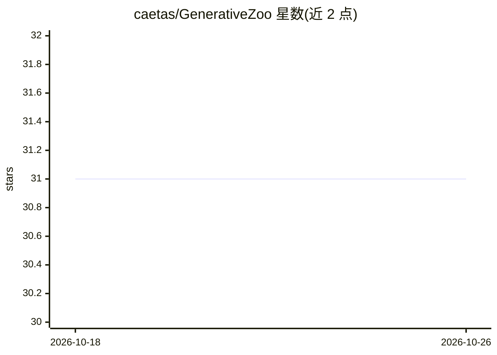

# caetas/GenerativeZoo

⭐ 31 · Python · CC-BY-4.0 · 推送 2025-12-03 · [GitHub](https://github.com/caetas/GenerativeZoo) · [官网](https://caetas.github.io/generativezoo.html) · 个人维护

**生成模型算法合集：VAE/GAN/扩散/流匹配等统一训练框架**

用 Python 实现的生成式模型动物园，覆盖 VAE、GAN、DDPM、Score Matching、自回归、Normalizing Flows、Flow Matching 及 Stable Diffusion（含 LoRA、ControlNet、InstructPix2Pix）共 20 余种模型，各模型附论文、代码与脚本引用。部分模型支持 Multi-GPU 与 Mixed Precision 训练（基于 Accelerate），部分支持 latent space 实现。内置数据集自动下载，训练跟踪用 Weights & Biases。属 Xecs TASTI 项目，需 NVIDIA 驱动与 CUDA >= 12.1，通过 git clone + uv 或 Docker/Apptainer 安装运行。限制：需 W&B 账号与 secrets 文件，clone 要求 git ssh keys。

## 筛选速览

| 维度 | 判定 | 备注 |
|---|---|---|
| AI 角色 | `ai-native` | 本体是模型或模型工具 |
| 许可风险 | `viral` | CC-BY-4.0 |
| 部署形态 | `self-host` | docker 或自建部署 |
| 模型依赖 | — | README 未给出锁定关系 |
| 硬件要求 | — | 无带数字的原话,不猜 |
| 安装摩擦 | `low` | 无编译、无系统依赖或容器化 |
| 成熟度 | — | 结构信号不足 |

## 能力要点

- 覆盖 VAE/GAN/DDPM/Flow Matching/Normalizing Flows 等 20 余种生成模型实现
- 部分模型支持 Multi-GPU 与 Mixed Precision 训练（Accelerate）及 latent space
- 内置 16 个数据集（首次使用自动下载）
- 提供 Docker/Apptainer 镜像与 uv 环境管理

## 适用场景

- 在同一框架下对比训练不同类别的生成模型
- 学习各类生成算法的参考实现（附论文与来源代码链接）
- 科研实验中复现扩散、流匹配等训练流程并用 W&B 跟踪

## 场景标签

`模型训练` `科研工具` `微调` · 领域:学习与行业

## 证据(README 行号)

> L14: A collection of generative algorithms and techniques implemented in Python.
> L109: The listed models are already implemented and fully integrated in the model zoo. Models with 🚀 support Multi-GPU a
> L129: - DDPM 🚀📦 `Paper` | `Code` 7,8,9,21 | `Script` | `Documentation`

## 星数曲线

2026-10-18 31 → 2026-10-26 31（+0）

---
*卡片 v1 · prompt 1.4 · 生成 2026-10-26 · 置信度 mid · 依据 README sha `19f235dc223f` · [字段定义](../../DATASET.md)*
