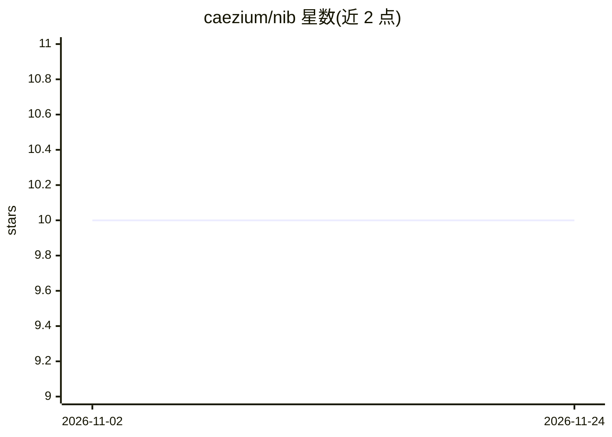

# caezium/nib

⭐ 10 · TypeScript · MIT · 推送 2026-08-08 · [GitHub](https://github.com/caezium/nib) · [官网](https://nib.henryzh.dev) · 个人维护

**把想法或文章转成角色一致手绘插图的 agent 技能与 macOS 应用**

Nib 将一个想法或整篇文章转换为手绘风格社论插图，每张图为白底、单主题，并固定使用用户自有的角色形象作为每次渲染的参考图以保持跨图一致性。以 Claude Code/Codex CLI/Cursor/Gemini CLI 的 agent 技能形式安装，另提供 TypeScript+React 的 macOS 桌面应用（含概念模式与文章模式）。生成走 Codex/Gemini CLI 订阅通道或 OpenRouter key，核心引擎为无第三方依赖的 Python 脚本；macOS 版本为自签名的 pre-1.0 构建。

## 筛选速览

| 维度 | 判定 | 备注 |
|---|---|---|
| AI 角色 | `ai-native` | 本体是模型或模型工具 |
| 许可风险 | `permissive` | MIT |
| 部署形态 | `desktop` | 安装包/桌面程序 |
| 模型依赖 | locked-api |  |
| 硬件要求 | — | 无带数字的原话,不猜 |
| 安装摩擦 | `low` | 无编译、无系统依赖或容器化 |
| 成熟度 | `idea` | |

## 能力要点

- 角色图像作为每次渲染的参考输入，跨多张插图保持角色一致
- 文章模式将 URL 或草稿生成 4–8 个关键瞬间的 shot list，可挑选后并行生成
- 提供 13 种视觉风格（marker/riso/woodcut/pixel 等）与透明背景输出选项（依赖可选的 rembg）
- 可通过 ChatGPT/Codex 订阅免费生成，无需 API key

## 适用场景

- 为博客文章、newsletter 或文档生成一系列角色一致的插图
- 用自己的吉祥物或头像形象批量产出社论风格图
- 把长文提炼为若干关键概念的配图 shot list

## 场景标签

`图像生成` · 领域:内容生成

## 证据(README 行号)

> L5: **Nib turns an idea — or a whole article — into hand-drawn editorial illustrations for your
> L37: Install the skill into your agent — one command, no app to download:
> L88: 4. **Generate**, reviewing each against the quality bar (white background, one idea, the

## 星数曲线

2026-11-02 10 → 2026-11-24 10（+0）

---
*卡片 v1 · prompt 1.4 · 生成 2026-11-19 · 置信度 mid · 依据 README sha `23795e75fa64` · [字段定义](../../DATASET.md)*
