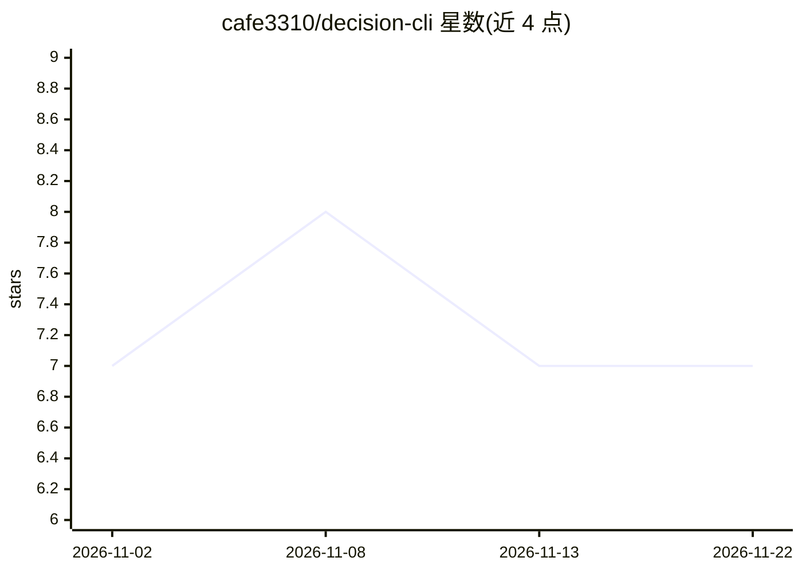

# cafe3310/decision-cli

⭐ 7 · Go · Apache-2.0 · 推送 2026-10-30 · [GitHub](https://github.com/cafe3310/decision-cli) · 个人维护 · 中文 README

**macOS 上本地部署 LLM 做分类判定任务的 CLI**

基于 Apple MLX 在 Apple Silicon 上运行本地模型，通过单步前向提取候选 Token 的 Logits 计算相对概率，输出分类标签与概率，用于二元判定、多分类、分级打分等判定任务。提供批量文件处理、SQLite 结果缓存、选项位置偏置消解、常驻 HTTP 服务（兼容 Jev 端点）等功能。面向需要在端侧私有运行判定模型、要求低延迟的用户。限制：仅支持 Apple Silicon Mac，macOS 13.0+，需 Go 与 Xcode 命令行工具编译安装。

## 筛选速览

| 维度 | 判定 | 备注 |
|---|---|---|
| AI 角色 | `ai-native` | 本体是模型或模型工具 |
| 许可风险 | `permissive` | Apache-2.0 |
| 部署形态 | `None` |  |
| 模型依赖 | — | README 未给出锁定关系 |
| 硬件要求 | — | 无带数字的原话,不猜 |
| 安装摩擦 | `low` | 无编译、无系统依赖或容器化 |
| 成熟度 | — | 结构信号不足 |

## 能力要点

- 单步前向提取候选 Token Logits 计算概率，单条约 45-170ms
- 支持纯文本与多模态视觉判定（noun/choose/score）
- 内置 JevBench 231 题评测集复现脚本与结果归档
- batch 批量流式判定与兼容 Jev /v1 端点的 HTTP 服务

## 适用场景

- 对用户反馈做本地私有化的分类与意图识别
- 对内容文件批量执行审核过滤
- 在 Apple Silicon 上以低延迟替代逐条 API 调用做判定

## 场景标签

`模型评测` `多模态` · 领域:评测与运维

## 证据(README 行号)

> L3: 本地部署决策模型，通过命令行提供批量处理与 Jev-like API，基于 MLX 运行在 Apple Silicon 上，支持文本与多模态。
> L11: `decision-cli` 在单步前向中直接提取候选 Token（如「是」与「否」或选项字母）的 Logits 计算相对概率。单条计算仅需单次前向，耗时约数十至百余毫秒（端侧轻量模型约 45ms）。相同输入或调整判定阈值时读取本

## 星数曲线

2026-11-02 7 → 2026-11-22 7（+0）

---
*卡片 v1 · prompt 1.4 · 生成 2026-11-20 · 置信度 high · 依据 README sha `e97f216abd94` · [字段定义](../../DATASET.md)*
