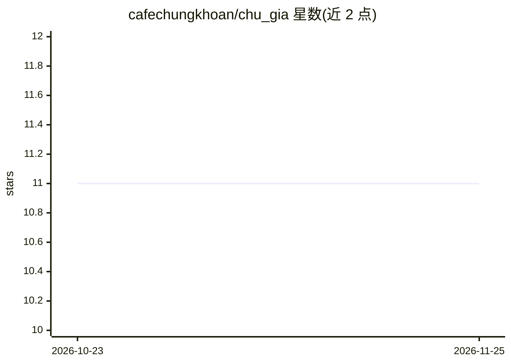

# cafechungkhoan/chu_gia

⭐ 11 · Jupyter Notebook · 推送 2026-09-15 · [GitHub](https://github.com/cafechungkhoan/chu_gia) · [官网](http://cafechungkhoan.com/) · 个人维护

**证券公司数据科学从业者的个人主页仓库**

该仓库是越南证券公司（VCI）ABS 部门从业者 Lê Đặng Trung Hiếu 的 GitHub 个人资料页，内容为个人简介：职业身份、兴趣领域（数学、股市、营销、数据科学）与技能列表（SEO、数字广告、Python 数据科学与机器学习）。仓库描述称汇总公开 Data Science 与 Machine Learning 项目，但可见 README 内未含项目清单、安装说明或代码使用方法，实际内容需查看仓库其他文件。

## 筛选速览

| 维度 | 判定 | 备注 |
|---|---|---|
| AI 角色 | `ai-knowledge` | 知识聚合/清单类 |
| 许可风险 | `none` | — |
| 部署形态 | `None` |  |
| 模型依赖 | — | README 未给出锁定关系 |
| 硬件要求 | — | 无带数字的原话,不猜 |
| 安装摩擦 | `low` | 无编译、无系统依赖或容器化 |
| 成熟度 | — | 结构信号不足 |

## 能力要点

- 个人资料页形式，无功能性代码说明
- 描述提及汇总公开 Data Science/ML 项目
- 技能列表涵盖 SEO、数字广告与 Python

## 适用场景

- 了解该作者的背景与技能方向
- 作为其数据科学项目汇总的入口

## 场景标签

 · 领域:个人资料页/数据科学

## 证据(README 行号)

> L3: - :zap: I love math, stock market, marketing and data science.
> L12:  - :atom: Python (Programming Language) for Data Science & Machine Learning

## 星数曲线

2026-10-23 11 → 2026-11-25 11（+0）

---
*卡片 v1 · prompt 1.4 · 生成 2026-11-18 · 置信度 low · 依据 README sha `5462034ea838` · [字段定义](../../DATASET.md)*
