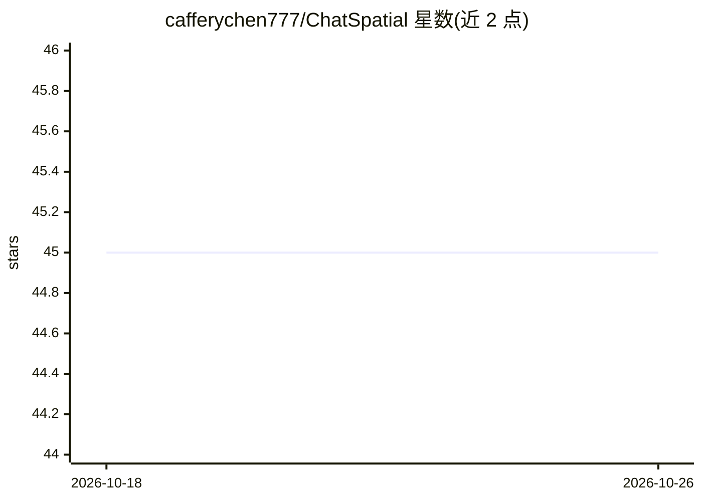

# cafferychen777/ChatSpatial

⭐ 45 · Python · MIT · 推送 2026-10-20 · [GitHub](https://github.com/cafferychen777/ChatSpatial) · [官网](https://docs.cafferyang.com/) · 组织维护

**空间转录组分析 MCP server：自然语言调用 67 种方法**

面向空间转录组学的 MCP 服务器：通过 20 个 schema 校验的 MCP 工具编排 67 种分析方法（13 个分析类别），覆盖数据预处理、空间域识别、去卷积、细胞通讯、轨迹推断等。以 schema 约束的工具注册表替代临时 LLM 代码生成，使工作流在不同会话与客户端间可复现。支持 10x Visium、Xenium、Slide-seq v2、MERFISH、seqFISH 数据，兼容任意 MCP 客户端；标准运行时经 uvx 安装，Docker 与复现镜像可用，部分方法族（R 桥等）需单独处理。

## 筛选速览

| 维度 | 判定 | 备注 |
|---|---|---|
| AI 角色 | `ai-ecosystem` | LLM/agent 周边工具 |
| 许可风险 | `permissive` | MIT |
| 部署形态 | `self-host` | docker 或自建部署 |
| 模型依赖 | — | README 未给出锁定关系 |
| 硬件要求 | — | 无带数字的原话,不猜 |
| 安装摩擦 | `low` | 无编译、无系统依赖或容器化 |
| 成熟度 | — | 结构信号不足 |

## 能力要点

- 20 个 MCP 工具编排 67 种空间转录组方法（13 类）
- schema 约束的工具选择替代任意代码生成，提升可复现性
- 支持 MCP 2026-07-28 协议并向旧版客户端协商兼容
- 发布 -repro 复现镜像，无 LLM 调用即可重跑论文关键结果

## 适用场景

- 在 Claude Code 等 MCP 客户端中用自然语言完成空间转录组分析
- 生物学者复现 DLPFC 空间域与 OSCC 去卷积实验结果
- 跨会话、跨客户端重复执行同一套分析工作流

## 场景标签

`数据分析` · 领域:效率与自动化

## 证据(README 行号)

> L3: **MCP server for spatial transcriptomics analysis via natural language**
> L20: ChatSpatial exposes **20 schema-validated MCP tools** that orchestrate **67 spatial transcriptomics methods** acros
> L22: The server implements MCP `2026-07-28` through the official Python SDK v2 and

## 星数曲线

2026-10-18 45 → 2026-10-26 45（+0）

---
*卡片 v1 · prompt 1.4 · 生成 2026-10-25 · 置信度 high · 依据 README sha `4a65afe2ba0a` · [字段定义](../../DATASET.md)*
