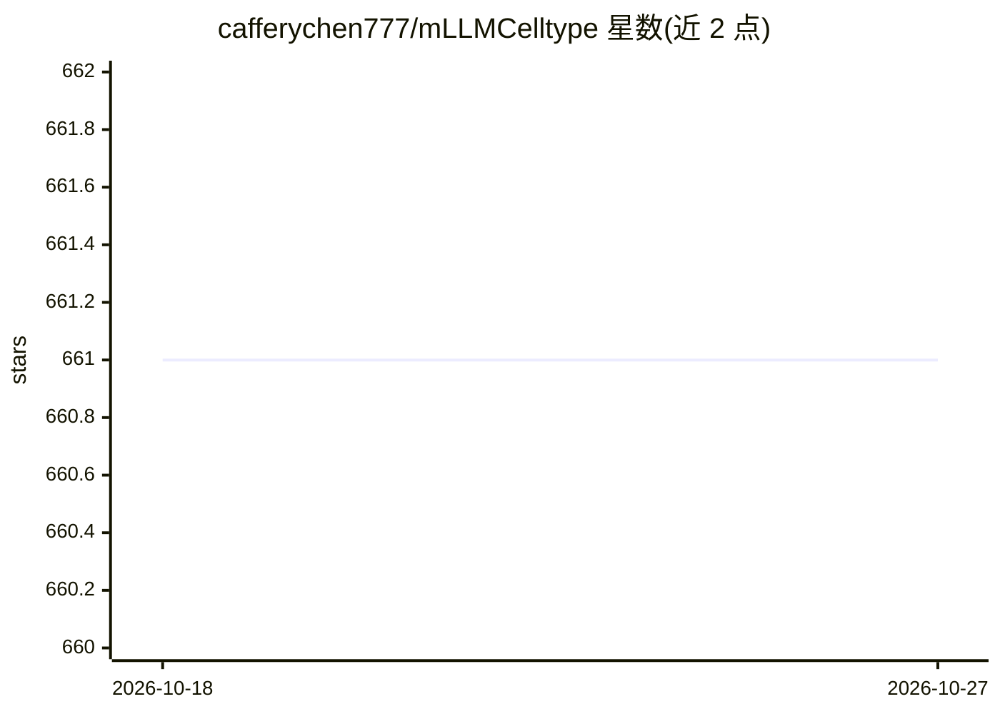

# cafferychen777/mLLMCelltype

⭐ 661 · Python · MIT · 推送 2026-09-28 · [GitHub](https://github.com/cafferychen777/mLLMCelltype) · [官网](https://www.mllmcelltype.com/) · 个人维护 · 中文 README

**多 LLM 共识的单细胞 RNA 测序细胞类型注释工具**

面向单细胞转录组研究者的细胞类型注释工具：将多个大语言模型（OpenAI、Anthropic、Google、DeepSeek、Qwen 等 10+ 提供商）对同一 marker 基因列表的预测进行共识整合，通过多轮讨论与共识检查模型裁决分歧，输出 Consensus Proportion 与 Shannon Entropy 等不确定性指标。无需参考数据集即可注释，兼容 Scanpy/Seurat 工作流，也支持 CSV 直接输入。同时提供 R 包（CRAN）、Python 包（PyPI）与 Colab notebook。限制：依赖各 LLM 的 API Key（免费路径为 OpenRouter 免费模型，含每日 50 次请求限制）。

## 筛选速览

| 维度 | 判定 | 备注 |
|---|---|---|
| AI 角色 | `ai-native` | 本体是模型或模型工具 |
| 许可风险 | `permissive` | MIT |
| 部署形态 | `library` | 以包/库形式分发 |
| 模型依赖 | locked-api |  |
| 硬件要求 | — | 无带数字的原话,不猜 |
| 安装摩擦 | `low` | 无编译、无系统依赖或容器化 |
| 成熟度 | — | 结构信号不足 |

## 能力要点

- 多 LLM 共识机制含多轮讨论与共识检查模型裁决
- Consensus Proportion 与 Shannon Entropy 不确定性指标
- 免参考数据集注释，兼容 Scanpy/Seurat 与 CSV 输入
- R 与 Python 双包发布（CRAN/PyPI），支持 OpenRouter 免费模型路径

## 适用场景

- 我有 scRNA-seq 聚类的 marker 基因，想自动注释细胞类型
- 想识别哪些簇的注释不确定、需要人工复核
- 无参考数据集且只有 OpenRouter 免费额度时完成注释

## 场景标签

`数据分析` `科研工具` · 领域:效率与自动化

## 证据(README 行号)

> L17: mLLMCelltype is a multi-LLM consensus framework for automated cell type annotation in single-cell RNA sequencing (s
> L21: mLLMCelltype is an open-source tool for single-cell transcriptomics analysis that uses multiple large language mode
> L51: - **Integration**: Compatible with Scanpy/Seurat workflows and marker gene outputs

## 星数曲线

2026-10-18 661 → 2026-10-27 661（+0）

---
*卡片 v1 · prompt 1.4 · 生成 2026-10-22 · 置信度 high · 依据 README sha `c14e8574655e` · [字段定义](../../DATASET.md)*
