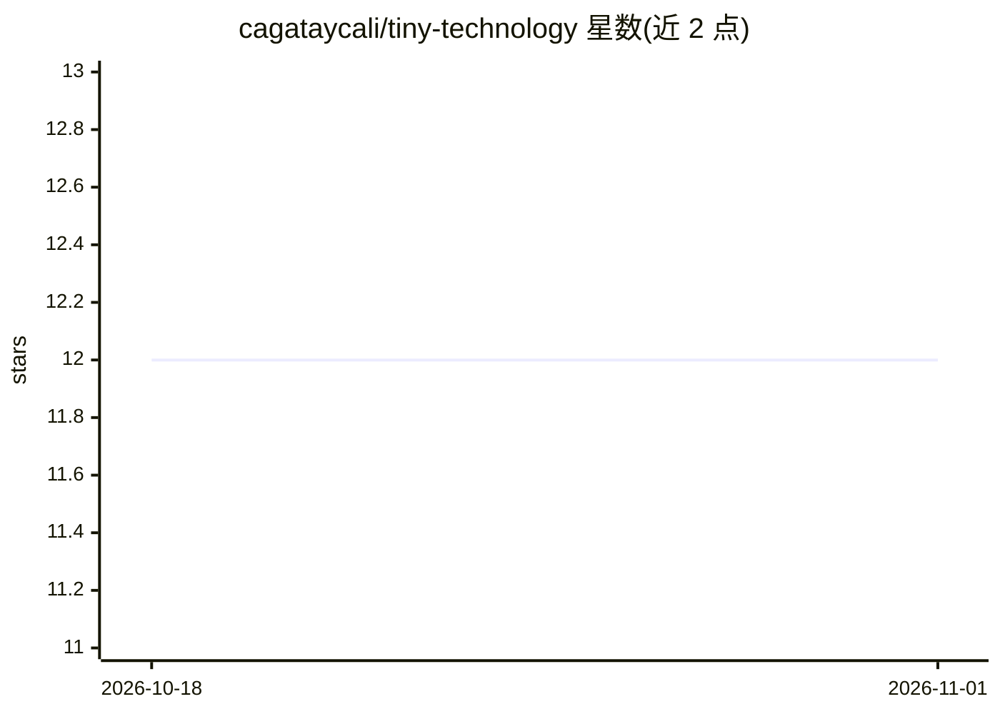

# cagataycali/tiny-technology

⭐ 12 · TypeScript · Apache-2.0 · 推送 2026-09-17 · [GitHub](https://github.com/cagataycali/tiny-technology) · [官网](https://tiny.technology) · 个人维护

**通过对话创建个人 AI 的平台：每个 AI 有 URL、记忆、设备载体与钱包**

面向终端用户的应用：用户用一句话创建具有名称、URL、持久记忆、语音与钱包的 AI 实体。技术上由 Next.js 16 前端、Cloudflare Workers 后端、iOS/Android 应用、Solidity 链上组件与 Arduino Nicla 可穿戴硬件组成；提供 68 个内置工具，支持手机作为设备载体（震动、相机、截屏等，调用可追踪）、双时态记忆图、cron 后台任务、x402/USDC 按消息计费（平台每付费调用收 0.001 美元）。自带 BYO-key 模型接入（十家提供商），可自托管，Apache-2.0 开源。

## 筛选速览

| 维度 | 判定 | 备注 |
|---|---|---|
| AI 角色 | `ai-native` | 本体是模型或模型工具 |
| 许可风险 | `permissive` | Apache-2.0 |
| 部署形态 | `library` | 以包/库形式分发 |
| 模型依赖 | — | README 未给出锁定关系 |
| 硬件要求 | — | 无带数字的原话,不猜 |
| 安装摩擦 | `low` | 无编译、无系统依赖或容器化 |
| 成熟度 | — | 结构信号不足 |

## 能力要点

- 一句话创建带 URL 与持久记忆的 AI 实体（bitemporal 记忆图）
- 68 个内置工具：手机设备控制、语音对话、定时任务、自写工具
- x402/USDC 双向付费：可按消息定价收款，支出需用户确认
- 可穿戴硬件项链（Arduino Nicla，约 48ms 端侧推理），CLI/MCP 客户端接入

## 适用场景

- 我想拥有一个不被平台收回的、可导出记忆的个人 AI
- 让我的 AI 在多设备（手机、手表、项链）上执行动作并打语音电话
- 给自建 AI 定价收费，人和其他 agent 都能付费调用

## 场景标签

`AI 助手` `Agent 记忆` `语音 Agent` · 领域:Agent 开发

## 证据(README 行号)

> L16: You talk to me, and I make you an AI. Not a chatbot with a wig — a thing with a
> L72: |🧬|**Make another AI** — describe one in a sentence and it exists, with its own URL, prompt, knowledge and toolbelt

## 星数曲线

2026-10-18 12 → 2026-11-01 12（+0）

---
*卡片 v1 · prompt 1.4 · 生成 2026-11-01 · 置信度 high · 依据 README sha `ded12d2d9ce3` · [字段定义](../../DATASET.md)*
