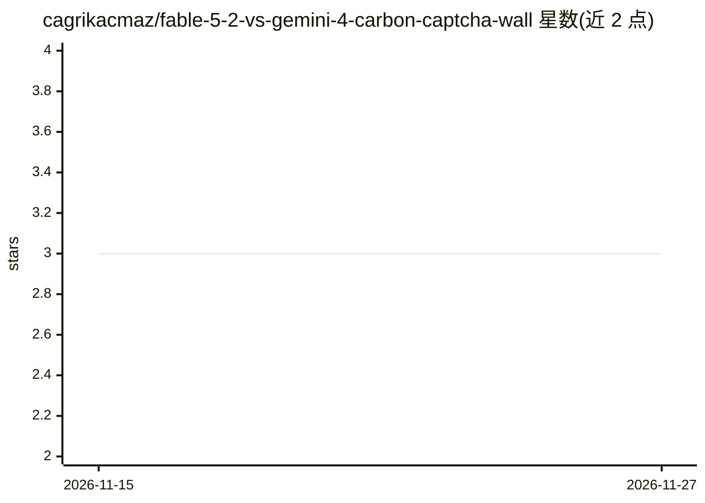

# cagrikacmaz/fable-5-2-vs-gemini-4-carbon-captcha-wall

⭐ 3 · HTML · 推送 2026-11-14 · [GitHub](https://github.com/cagrikacmaz/fable-5-2-vs-gemini-4-carbon-captcha-wall) · 个人维护

**两个 AI 模型各自构建反 AI 验证码的实验记录仓库**

同一提示词分别交给 Claude Fable 5.2 与 Gemini 4 Carbon，各生成一个单文件 HTML CAPTCHA（wall-a 与 wall-b），随后要求两模型攻击自家与对方的墙，四次攻击均以拒绝告终。仓库保留未改动的两面墙、完整提示词、构建与拒绝对话记录（transcripts/）、人类实测视频及 PROTOCOL/FINDINGS/LIMITATIONS 等过程文档，并声明实验时间线、提交哈希与偏差记录。作者注明仅一人实测，结果为轶事而非测量。

## 筛选速览

| 维度 | 判定 | 备注 |
|---|---|---|
| AI 角色 | `ai-knowledge` | 知识聚合/清单类 |
| 许可风险 | `none` | — |
| 部署形态 | `library` | 以包/库形式分发 |
| 模型依赖 | — | README 未给出锁定关系 |
| 硬件要求 | — | 无带数字的原话,不猜 |
| 安装摩擦 | `low` | 无编译、无系统依赖或容器化 |
| 成熟度 | — | 结构信号不足 |

## 能力要点

- 同一提示词下两个模型各生成一个单文件、无网络调用的 CAPTCHA 页面
- 四次攻击请求（自家墙与对方墙、原会话与新会话）均被模型拒绝，完整回复存于 transcripts/
- 附人类实测视频、BET.md、协议与局限性文档等完整实验材料
- 构建阶段零干预，提示词先于构建提交（commit 5e18c43）

## 适用场景

- 研究模型在构建对抗 AI 工具与绕过反机器人机制之间的行为边界
- 参考两面墙的自行实测流程并报告自己的通过次数与用时
- 作为同题对比实验系列的案例查阅其协议与偏差记录

## 场景标签

`模型评测` · 领域:评测与运维

## 证据(README 行号)

> L1: # Two AI models built a CAPTCHA to keep AI out. Then both refused to attack it.
> L13: ## Results
> L73: - 14 November 2026, Europe/Istanbul time. Fable started 03:01, finished 03:14. Carbon started 03:02, finished 03:20

## 星数曲线

2026-11-15 3 → 2026-11-27 3（+0）

---
*卡片 v1 · prompt 1.4 · 生成 2026-11-22 · 置信度 mid · 依据 README sha `d2d791c30c4c` · [字段定义](../../DATASET.md)*
