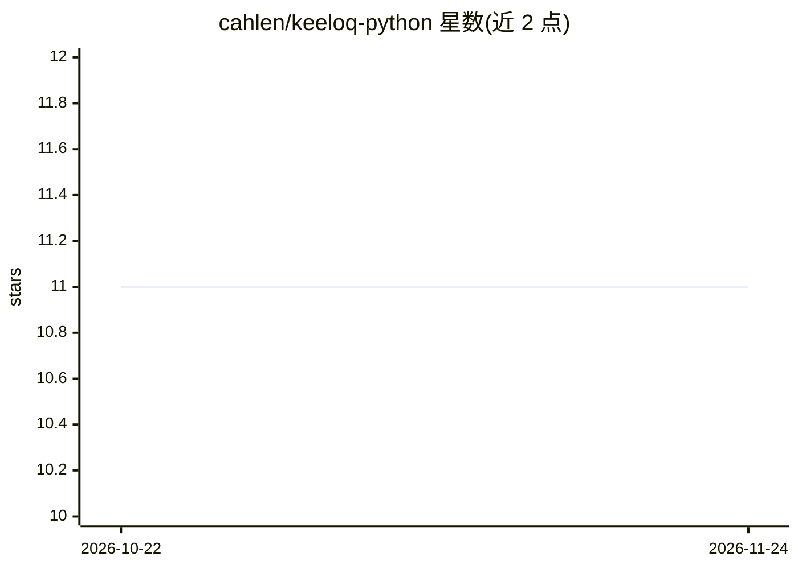

# cahlen/keeloq-python

⭐ 11 · Python · MIT · 推送 2026-04-23 · [GitHub](https://github.com/cahlen/keeloq-python) · 个人维护

**对降轮 KeeLoq 密码的代数+神经网络差分密码分析工具**

针对 KeeLoq 分组密码提供两条独立攻击管线，通过统一 keeloq CLI 驱动：其一为基于 CryptoMiniSat（原生 XOR 子句）的代数/SAT 求解攻击，提供纯 CNF 与 XOR-aware ANF 编码器；其二为 Gohr 风格的 PyTorch ResNet-1D-CNN 神经区分器，配合贝叶斯束搜索密钥恢复，并将残余位交由 SAT 后缀求解。预训练区分器检查点发布于 Hugging Face。运行要求 Linux x86_64 与 Python 3.12，使用 uv 管理依赖；神经管线需 CUDA GPU，代数攻击可在 CPU 运行。

## 筛选速览

| 维度 | 判定 | 备注 |
|---|---|---|
| AI 角色 | `ai-native` | 本体是模型或模型工具 |
| 许可风险 | `permissive` | MIT |
| 部署形态 | `None` |  |
| 模型依赖 | — | README 未给出锁定关系 |
| 硬件要求 | — | 无带数字的原话,不猜 |
| 安装摩擦 | `medium` | 含编译或系统依赖之一 |
| 成熟度 | — | 结构信号不足 |

## 能力要点

- 64 轮 64 位密钥恢复的代数攻击命令行流程，SAT 求解前强制密钥验证
- Gohr 风格 PyTorch ResNet 神经区分器 + 贝叶斯束搜索 + SAT 后缀混合恢复
- 预训练检查点发布于 Hugging Face（cahlen/keeloq-neural-distinguishers）
- 管线各阶段以 JSON stdin/stdout 暴露，可经 Unix 管道组合

## 适用场景

- 对降轮 KeeLoq 实现做学术性密码分析实验
- 复现或评估神经差分区分器的训练与攻击流程
- 研究 SAT/神经网络混合密码分析管线的组合方式

## 场景标签

`网络安全` · 领域:学习与行业

## 证据(README 行号)

> L7: Two independent cryptanalysis pipelines against reduced-round KeeLoq, both drivable from a single `keeloq` CLI:
> L11: 2. **Neural differential (Gohr 2019 style)** — PyTorch ResNet-1D-CNN distinguisher trained on a GPU bit-sliced KeeL

## 星数曲线

2026-10-22 11 → 2026-11-24 11（+0）

---
*卡片 v1 · prompt 1.4 · 生成 2026-11-18 · 置信度 high · 依据 README sha `cf07043b9ec9` · [字段定义](../../DATASET.md)*
