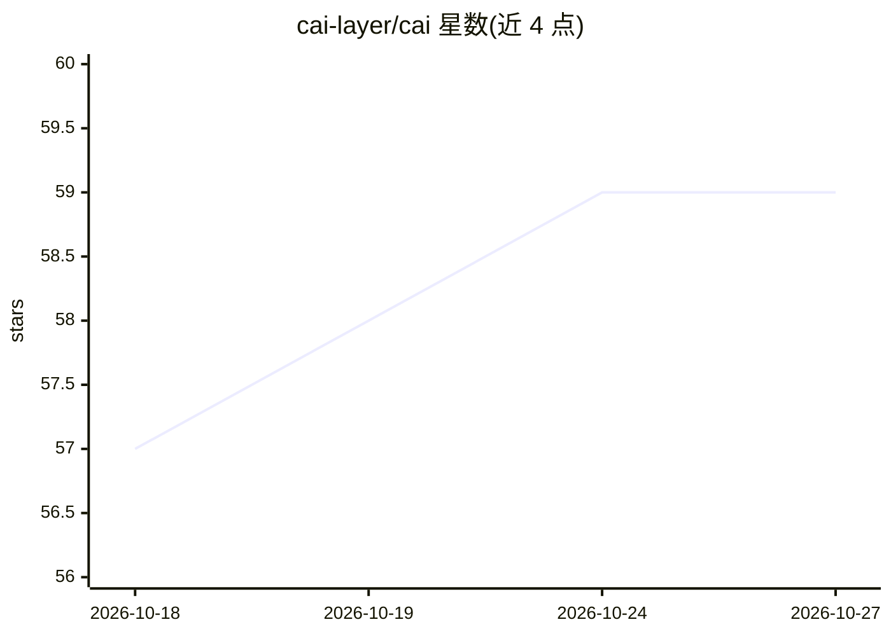

# cai-layer/cai

⭐ 59 · Swift · MIT · 推送 2026-10-11 · [GitHub](https://github.com/cai-layer/cai) · [官网](https://getcai.app/) · 组织维护

**macOS 本地 AI 快捷动作启动器：选中内容按 ⌥C 即变换**

macOS 菜单栏应用：任意位置选中文本或图片后按 ⌥C，触发 AI 提示词、shell 脚本、URL 模板及 GitHub/Linear 连接器组成的动作或动作链，结果自动复制回剪贴板。可让 Claude Code、Cursor、Codex 通过 MCP 代写动作，用户审批一次后本地永久运行。内置 AI 支持 Apple Intelligence 或 Apple Silicon 上的进程内 MLX 推理，也可接 Ollama、LM Studio 等。无云、无遥测、无账号，需 macOS 14+ 与辅助功能权限。

## 筛选速览

| 维度 | 判定 | 备注 |
|---|---|---|
| AI 角色 | `ai-enhanced` | 去掉 AI 部分产品仍成立 |
| 许可风险 | `permissive` | MIT |
| 部署形态 | `desktop` | 安装包/桌面程序 |
| 模型依赖 | local-ok | 支持本地模型 |
| 硬件要求 | — | 无带数字的原话,不猜 |
| 安装摩擦 | `low` | 无编译、无系统依赖或容器化 |
| 成熟度 | — | 结构信号不足 |

## 能力要点

- 选中任意内容按 ⌥C 运行 AI/脚本/连接器动作并支持链式组合
- 作为 MCP 服务器让 Claude Code/Cursor/Codex 代写动作，用户审批一次后脱离 agent 运行
- 内置 Apple Intelligence 或进程内 MLX 推理，100% 本地、无遥测无账号
- API 令牌存于 macOS Keychain，agent 仅见名称不可见明文

## 适用场景

- 选中文本快速翻译、摘要、定义或发到 GitHub/Linear
- 让常用编码 agent 帮我生成并沉淀个人快捷动作
- 本地运行 LLM 处理剪贴板内容而不上云

## 场景标签

`AI 助手` `AI 写作` · 领域:对话与助手

## 证据(README 行号)

> L21: Select any text or image anywhere, press **⌥C**, and run AI prompts, shell scripts, and connectors like GitHub and 
> L63: - **Smart content detection** — recognizes what you copied (text, image, URL, JSON, meeting, address) and shows the
> L69: - **Action chains** — pipe selection through AI prompts, scripts, and destinations (Slack, GitHub, Apple Shortcuts)

## 星数曲线

2026-10-18 57 → 2026-10-27 59（+2）

---
*卡片 v1 · prompt 1.4 · 生成 2026-10-24 · 置信度 high · 依据 README sha `465a4c2d9e86` · [字段定义](../../DATASET.md)*
