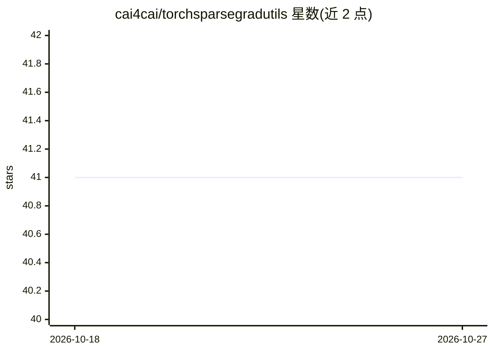

# cai4cai/torchsparsegradutils

⭐ 41 · Python · Apache-2.0 · 推送 2026-10-22 · [GitHub](https://github.com/cai4cai/torchsparsegradutils) · [官网](https://torchsparsegradutils.readthedocs.io/en/latest/) · 组织维护

**PyTorch 稀疏张量工具库：保持稀疏性的梯度运算与稀疏求解器**

面向使用 PyTorch 稀疏张量的开发者与科研人员的 Python 工具库：提供在反向传播中保持稀疏性的稀疏矩阵乘法（sparse_mm）、数值稳定的 sparse_logsumexp 归约、带可插拔后端的稀疏线性求解器（BiCGSTAB/CG/GMRES/LSMR/MINRES 纯 PyTorch 实现，可接 CuPy/JAX）、稀疏多元正态分布（支持 rsample 与 COO/CSR）、空间体素编码器与兼容 DGL/PyG 的图分段矩阵乘法。要求 Python≥3.10、PyTorch≥2.5，支持 Linux/macOS/Windows，CPU 与 CUDA GPU。

## 筛选速览

| 维度 | 判定 | 备注 |
|---|---|---|
| AI 角色 | `ai-ecosystem` | LLM/agent 周边工具 |
| 许可风险 | `permissive` | Apache-2.0 |
| 部署形态 | `self-host` | docker 或自建部署 |
| 模型依赖 | — | README 未给出锁定关系 |
| 硬件要求 | — | 无带数字的原话,不猜 |
| 安装摩擦 | `low` | 无编译、无系统依赖或容器化 |
| 成熟度 | — | 结构信号不足 |

## 能力要点

- 反向传播中保持梯度稀疏性的稀疏矩阵运算与归约
- 内置 BiCGSTAB/CG/GMRES/LSMR/MINRES 纯 PyTorch 迭代求解器
- SparseMultivariateNormal 分布支持重参数化采样与 LL^T/LDL^T 参数化
- segment_mm/gather_mm 兼容 DGL/PyG 的图操作

## 适用场景

- 稀疏模型训练中避免梯度稠密化导致内存膨胀
- 求解稀疏线性系统（如 PDE/CFD 离散后的大规模方程）
- 为医学影像等体数据构建稀疏空间邻域编码
- 稀疏多元正态分布建模与采样

## 场景标签

 · 领域:深度学习/科学计算库

## 证据(README 行号)

> L5: A comprehensive collection of utility functions to work with PyTorch sparse tensors, ensuring memory efficiency and 
> L12: - `sparse_mm`: Memory-efficient sparse matrix multiplication with batch support

## 星数曲线

2026-10-18 41 → 2026-10-27 41（+0）

---
*卡片 v1 · prompt 1.4 · 生成 2026-10-25 · 置信度 mid · 依据 README sha `a8953cda7f86` · [字段定义](../../DATASET.md)*
