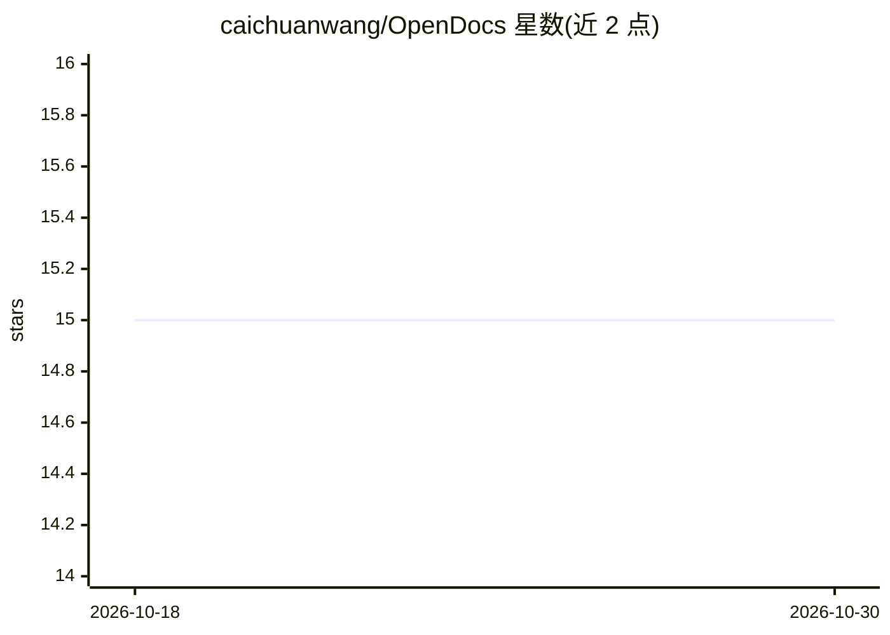

# caichuanwang/OpenDocs

⭐ 15 · Python · MIT · 推送 2026-08-21 · [GitHub](https://github.com/caichuanwang/OpenDocs) · 个人维护 · 中文 README

**Python SDK：将本地 PDF/Office/图片等文档转为 Markdown**

OpenDocs 是一个 Python 库（opendocs-sdk），把 TXT、Markdown、PDF、DOCX、PPTX、XLSX 和 PNG/JPEG/WebP 图片转换为 Markdown，提供统一的同步与异步 API。PDF 支持逐页 native/hybrid/full-vision/blank 路由；配置 VisionConfig 时经 LiteLLM 适配器调用视觉模型解析图片与视觉 PDF，并需 Poppler（仅视觉/混合 PDF）。输入仅限本地文件与字节流，调用方自行处理远程下载；不重算公式、不保留 Excel 视觉样式；类型化异常与警告。当前为 0.2.0 Alpha，Ubuntu/macOS 上验证，Windows 未验证。

## 筛选速览

| 维度 | 判定 | 备注 |
|---|---|---|
| AI 角色 | `ai-enhanced` | 去掉 AI 部分产品仍成立 |
| 许可风险 | `permissive` | MIT |
| 部署形态 | `library` | 以包/库形式分发 |
| 模型依赖 | — | README 未给出锁定关系 |
| 硬件要求 | — | 无带数字的原话,不猜 |
| 安装摩擦 | `low` | 无编译、无系统依赖或容器化 |
| 成熟度 | `idea` | |

## 能力要点

- 六类格式到 Markdown 的统一 sync/async API
- 可选 LLM 视觉解析（经 LiteLLM 适配器，供应商中立）
- PDF 逐页 native/hybrid/full-vision/blank 路由
- 类型化异常与可恢复降级警告

## 适用场景

- 把本地 PDF/Word/PPT/Excel 批量转成 Markdown 供知识库或 RAG 使用
- 需要视觉模型辅助解析扫描版 PDF 和图片
- 在异步服务中并发处理多份文档并做错误分类处理

## 场景标签

`文档解析` · 领域:知识与检索

## 证据(README 行号)

> L12: OpenDocs is a Python SDK that converts local documents into clean Markdown —
> L78: Image and visual PDF work uses the provider-neutral LiteLLM
> L92: Standalone images require `VisionConfig`. PDFs and Office documents without vision configuration

## 星数曲线

2026-10-18 15 → 2026-10-30 15（+0）

---
*卡片 v1 · prompt 1.4 · 生成 2026-10-30 · 置信度 high · 依据 README sha `c896ba800e1e` · [字段定义](../../DATASET.md)*
