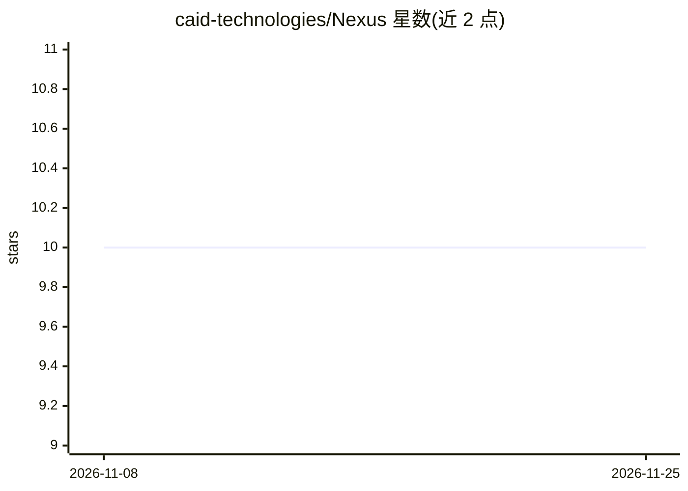

# caid-technologies/Nexus

⭐ 10 · TypeScript · GPL-3.0 · 推送 2026-11-19 · [GitHub](https://github.com/caid-technologies/Nexus) · 组织维护

**面向 CAD/3D 创作者的 agentic 生成式设计工作区**

基于 Next.js 的全栈 agentic 工作区，用户输入文本提示或图片，经多 agent 流水线（Nemotron 意图解析、Claude 生成依赖图与 Build123d 代码、OpenCascade 本地编译）生成参数化 CAD 模型，Babylon.js 实时渲染并支持 STL 导出、自然语言编辑与版本历史。内置 4 提供商 LLM 级联回退、圆角自愈与 BREP 几何评分。面向 3D/CAD 设计与制造场景的用户。

## 筛选速览

| 维度 | 判定 | 备注 |
|---|---|---|
| AI 角色 | `ai-native` | 本体是模型或模型工具 |
| 许可风险 | `viral` | GPL-3.0 |
| 部署形态 | `library` | 以包/库形式分发 |
| 模型依赖 | locked-api |  |
| 硬件要求 | — | 无带数字的原话,不猜 |
| 安装摩擦 | `low` | 无编译、无系统依赖或容器化 |
| 成熟度 | — | 结构信号不足 |

## 能力要点

- Text→CAD 与 Image→CAD 双入口生成流水线
- 4 提供商 LLM 回退（Anthropic→OpenAI→Gemini→OpenRouter）
- guided_json 约束解码保证结构化输出有效
- OpenCascade BREP 真实几何评分与 STL 导出

## 适用场景

- 用文字或草图生成可 3D 打印的 CAD 模型
- 对已有设计做自然语言参数化修改
- 按评分阈值自动迭代优化几何质量

## 场景标签

`多智能体` · 领域:Agent 开发

## 证据(README 行号)

> L1: # Nexus
> L44: |Intent Parser|NVIDIA Nemotron NIM + `guided_json`|NL → guaranteed-valid structured JSON|
> L55: - **Text → CAD**

## 星数曲线

2026-11-08 10 → 2026-11-25 10（+0）

---
*卡片 v1 · prompt 1.4 · 生成 2026-11-19 · 置信度 mid · 依据 README sha `4f241e96b2c1` · [字段定义](../../DATASET.md)*
