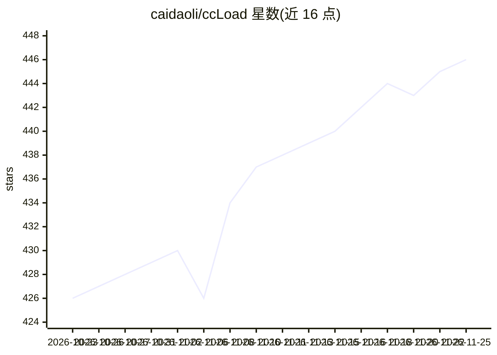

# caidaoli/ccLoad

⭐ 446 · Go · MIT · 推送 2026-11-24 · [GitHub](https://github.com/caidaoli/ccLoad) · [官网](https://ccload.xyz) · 个人维护 · 中文 README

**自托管 AI API 网关：聚合 API key 与订阅账号，统一端点供给编码 agent**

用 Go 编写的自托管网关：将官方 API key、第三方中转、ChatGPT/Claude 等订阅账号统一为 Channel，客户端只需 ccLoad 地址和 token 即可访问，客户端不接触真实上游密钥。核心机制包括按模型名路由、健康排序与平滑加权轮询、首字节前的故障转移与指数退避冷却、Anthropic/OpenAI/Codex/Gemini 协议互转，以及按缓存读写、长上下文分档计价的成本统计与限额。单二进制内嵌 SQLite，运行需设置管理员密码 CCLOAD_PASS，默认监听 8080 端口。

## 筛选速览

| 维度 | 判定 | 备注 |
|---|---|---|
| AI 角色 | `ai-ecosystem` | LLM/agent 周边工具 |
| 许可风险 | `permissive` | MIT |
| 部署形态 | `desktop` | 安装包/桌面程序 |
| 模型依赖 | — | README 未给出锁定关系 |
| 硬件要求 | — | 无带数字的原话,不猜 |
| 安装摩擦 | `low` | 无编译、无系统依赖或容器化 |
| 成熟度 | — | 结构信号不足 |

## 能力要点

- API key 与 Codex/ChatGPT、Claude 等订阅账号均可作为上游 Channel 接入
- Anthropic Messages、OpenAI Chat、Codex Responses、Gemini 协议互转，含 Responses over WebSocket
- 按 key/模型/渠道/客户端分级故障转移与指数退避冷却
- 成本统计覆盖缓存读写、长上下文分档，支持按渠道与 token 设支出上限

## 适用场景

- 多项 AI 订阅与零散 API key 合并后供 Claude Code/Codex 持续使用
- 团队给成员分发带预算与并发限制的 token
- 运营多条上游渠道并统一日志与成本管理

## 场景标签

`模型网关` · 领域:Agent 开发

## 证据(README 行号)

> L3: **Self-hosted AI API gateway for Claude Code, Codex, Gemini, and OpenAI-compatible clients.**
> L20: ccLoad is a gateway you run on your own computer or server. It manages all of those sources, and every client only 
> L201: - **Any client on any upstream**: Anthropic Messages, OpenAI Chat, Codex Responses and Gemini clients can all use 

## 星数曲线

2026-10-23 426 → 2026-11-25 446（+20）

---
*卡片 v1 · prompt 1.4 · 生成 2026-11-25 · 置信度 high · 依据 README sha `0f266810dd0e` · [字段定义](../../DATASET.md)*
