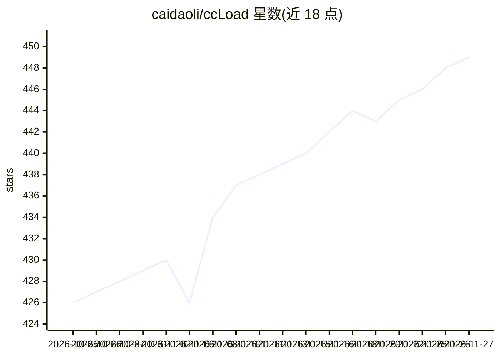

# caidaoli/ccLoad

⭐ 449 · Go · MIT · 推送 2026-11-26 · [GitHub](https://github.com/caidaoli/ccLoad) · [官网](https://ccload.xyz) · 个人维护 · 中文 README

**自托管 AI API 网关：聚合密钥与订阅账号供编码客户端共用**

自托管的 AI API 网关，将官方 API key、中转服务与 ChatGPT/Claude 等订阅账号统一为「渠道」，客户端只需配置 ccLoad 地址与 token 即可接入；提供故障转移、协议转换（Anthropic Messages/OpenAI Chat/Codex Responses/Gemini 互转）、按模型名路由、指数退避冷却、请求日志与成本统计/限额。以单个 Go 二进制 + 内嵌 SQLite 运行，内置管理控制台，支持 Docker/Homebrew/二进制/Hugging Face Spaces 部署。

## 筛选速览

| 维度 | 判定 | 备注 |
|---|---|---|
| AI 角色 | `ai-ecosystem` | LLM/agent 周边工具 |
| 许可风险 | `permissive` | MIT |
| 部署形态 | `desktop` | 安装包/桌面程序 |
| 模型依赖 | locked-api |  |
| 硬件要求 | — | 无带数字的原话,不猜 |
| 安装摩擦 | `low` | 无编译、无系统依赖或容器化 |
| 成熟度 | — | 结构信号不足 |

## 能力要点

- 订阅账号可作为上游渠道（Codex/Claude/Cursor 等），token 自动刷新
- 上游失败在首字节前对客户端透明的重试与分粒度冷却
- 协议转换：不同客户端协议可访问任一渠道
- 成本核算含缓存读写、长上下文分层与按渠道/按 token 限额

## 适用场景

- 多个 AI 订阅与备用 key 合并，Claude Code/Codex 额度耗尽时自动切换
- 团队按成员发放 token，设置模型/预算/并发限制并随时吊销
- 运维者统一管理多渠道，监控每个请求日志与费用

## 场景标签

`模型网关` · 领域:Agent 开发

## 证据(README 行号)

> L3: **Self-hosted AI API gateway for Claude Code, Codex, Gemini, and OpenAI-compatible clients.**
> L20: ccLoad is a gateway you run on your own computer or server. It manages all of those sources, and every client only 

## 星数曲线

2026-10-25 426 → 2026-11-27 449（+23）

---
*卡片 v1 · prompt 1.4 · 生成 2026-11-26 · 置信度 high · 依据 README sha `738972558065` · [字段定义](../../DATASET.md)*
