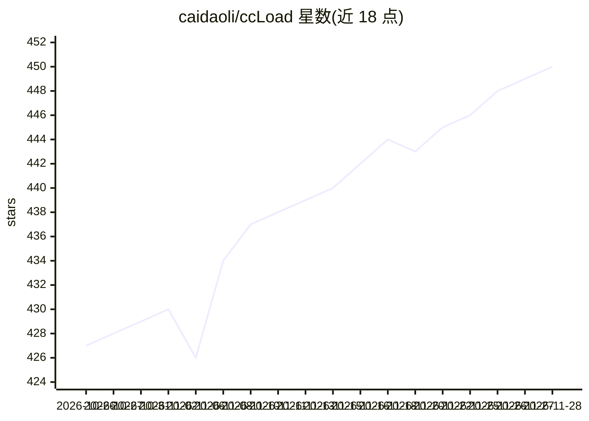

# caidaoli/ccLoad

⭐ 450 · Go · MIT · 推送 2026-11-27 · [GitHub](https://github.com/caidaoli/ccLoad) · [官网](https://ccload.xyz) · 个人维护 · 中文 README

**自托管 AI API 网关：为多客户端聚合密钥与订阅账号**

ccLoad 是一个用 Go 编写的自托管 API 网关，把官方 API key、第三方中转服务和 ChatGPT/Claude 等订阅账号统一为可管理的 Channel，客户端只需一个地址和一个 ccLoad token 即可访问。提供按模型名的路由与优先级调度、首个字节前失败即切换的 failover、按范围的冷却退避、协议转换（Anthropic/OpenAI/Codex/Gemini 互转）、按轮次动态推理深度、占位符脱敏和按渠道/令牌的费用统计与上限。单二进制内嵌 SQLite，带 Web 管理台。

## 筛选速览

| 维度 | 判定 | 备注 |
|---|---|---|
| AI 角色 | `ai-ecosystem` | LLM/agent 周边工具 |
| 许可风险 | `permissive` | MIT |
| 部署形态 | `desktop` | 安装包/桌面程序 |
| 模型依赖 | locked-api |  |
| 硬件要求 | — | 无带数字的原话,不猜 |
| 安装摩擦 | `low` | 无编译、无系统依赖或容器化 |
| 成熟度 | — | 结构信号不足 |

## 能力要点

- 将 API key 与 Codex/Claude 等订阅账号统一为 Channel 并按模型名路由
- failover 与指数退避冷却，流内限速与伪装 200 也计为失败
- Anthropic Messages、OpenAI Chat、Codex Responses、Gemini 协议互转（含 WebSocket）
- 费用统计覆盖缓存读写与长上下文档位，支持按渠道/令牌设上限

## 适用场景

- 多个 AI 订阅与 API key 合一，Claude Code/Codex 配额用尽不断会话
- 团队内按成员发放带预算和并发限制的令牌，上游凭据集中管理
- 多渠道运维：优先级、健康排序、定时检查与 CSV 导入导出

## 场景标签

`模型网关` · 领域:Agent 开发

## 证据(README 行号)

> L3: **Self-hosted AI API gateway for Claude Code, Codex, Gemini, and OpenAI-compatible clients.**
> L20: ccLoad is a gateway you run on your own computer or server. It manages all of those sources, and every client only 
> L201: - **Any client on any upstream**: Anthropic Messages, OpenAI Chat, Codex Responses and Gemini clients can all use 

## 星数曲线

2026-10-26 427 → 2026-11-28 450（+23）

---
*卡片 v1 · prompt 1.4 · 生成 2026-11-28 · 置信度 high · 依据 README sha `81a91eefbf79` · [字段定义](../../DATASET.md)*
