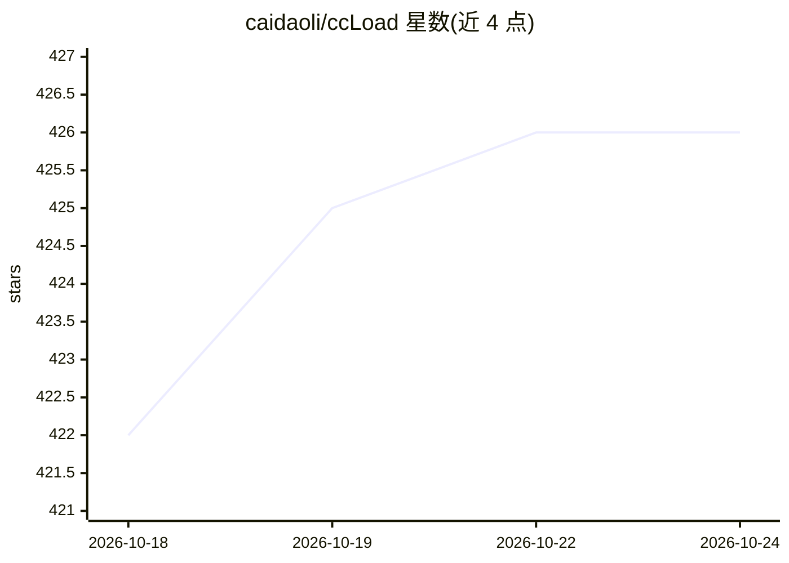

# caidaoli/ccLoad

⭐ 426 · Go · MIT · 推送 2026-10-22 · [GitHub](https://github.com/caidaoli/ccLoad) · [官网](https://ccload.xyz) · 个人维护 · 中文 README

**自托管 AI API 网关：聚合多来源账号与密钥，供 Claude Code/Codex 等客户端统一接入**

用 Go 编写的单二进制 API 网关，运行在用户自己的电脑或服务器上：把官方 API key、第三方中转与 ChatGPT/Claude 等订阅账号聚合为多个 Channel，客户端只需一个 ccLoad 地址和 token。提供按模型名选路、优先级与加权轮询、分级失败转移与指数退避冷却、协议互转（Anthropic Messages/OpenAI Chat/Codex Responses/Gemini）、成本统计与按渠道/令牌限额，内置 SQLite 与管理控制台。安装方式含 Docker、Docker Compose、Homebrew 与各平台二进制，也可部署在 Hugging Face Spaces。必须设置 CCLOAD_PASS 管理密码，默认监听 8080 端口。

## 筛选速览

| 维度 | 判定 | 备注 |
|---|---|---|
| AI 角色 | `ai-ecosystem` | LLM/agent 周边工具 |
| 许可风险 | `permissive` | MIT |
| 部署形态 | `desktop` | 安装包/桌面程序 |
| 模型依赖 | — | README 未给出锁定关系 |
| 硬件要求 | — | 无带数字的原话,不猜 |
| 安装摩擦 | `low` | 无编译、无系统依赖或容器化 |
| 成熟度 | — | 结构信号不足 |

## 能力要点

- 聚合 API key 与订阅账号（Codex/ChatGPT、Claude、Cursor、Zed 等）为多渠道路由
- 协议互转：Anthropic Messages/OpenAI Chat/Codex Responses（含 WebSocket）/Gemini 客户端可互用任意渠道
- 分级失败转移：按 key/模型/渠道/客户端级别冷却，软错误（200 错误体、SSE 限流）同样触发
- 成本追踪与限额：缓存读写、长上下文分级计价，支持按渠道每日与按令牌的总额/日/月封顶

## 适用场景

- 我有多个 AI 订阅和 API key，想让 Claude Code/Codex 在某个额度用尽时自动切换
- 团队共享模型访问：给成员发独立令牌并设置模型、预算与并发限制
- 运维多渠道：优先级排序、健康检查、CSV 导入导出与逐请求日志

## 场景标签

`模型网关` · 领域:Agent 开发

## 证据(README 行号)

> L20: ccLoad is a gateway you run on your own computer or server. It manages all of those sources, and every client only 
> L115: Go to **API Tokens** (`/web/tokens.html`), create a token and copy it. Every client uses it to reach ccLoad; `/v1/

## 星数曲线

2026-10-18 422 → 2026-10-24 426（+4）

---
*卡片 v1 · prompt 1.4 · 生成 2026-10-21 · 置信度 high · 依据 README sha `a52485351ed0` · [字段定义](../../DATASET.md)*
