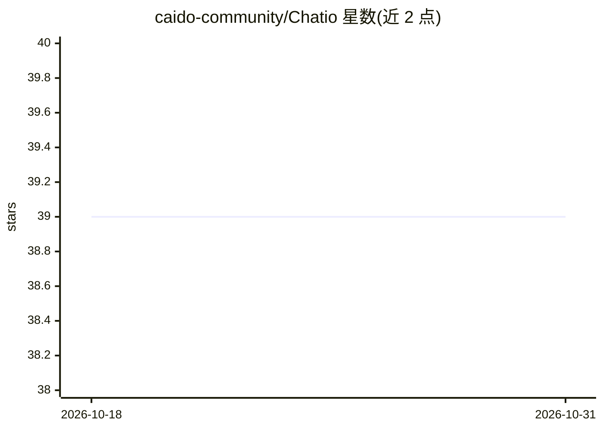

# caido-community/Chatio

⭐ 39 · Vue · MIT · 推送 2026-10-27 · [GitHub](https://github.com/caido-community/Chatio) · 组织维护

**面向渗透测试者的 Caido 插件：AI 安全测试助手**

Chatio 是为 Caido（Web 安全测试代理平台）构建的插件，面向渗透测试人员、安全研究员与网络安全从业者。功能包括智能分析、漏洞评估与安全测试各环节的专家指导；支持多个 AI 提供商，并内置面向安全的专用能力。通过 Caido 的 Plugin Store 搜索 Chatio 即可安装；完整文档（设置指南、安全模板、故障排查）内置于插件 Help 标签页。项目以 MIT 许可发布。

## 筛选速览

| 维度 | 判定 | 备注 |
|---|---|---|
| AI 角色 | `ai-native` | 本体是模型或模型工具 |
| 许可风险 | `permissive` | MIT |
| 部署形态 | `None` |  |
| 模型依赖 | — | README 未给出锁定关系 |
| 硬件要求 | — | 无带数字的原话,不猜 |
| 安装摩擦 | `low` | 无编译、无系统依赖或容器化 |
| 成熟度 | — | 结构信号不足 |

## 能力要点

- 作为 Caido 插件集成，经 Plugin Store 安装
- 提供智能分析、漏洞评估与安全测试指导
- 支持多个 AI 提供商
- 内置安全专用能力与安全模板

## 适用场景

- 渗透测试时在 Caido 内获得 AI 分析与漏洞评估
- 安全测试流程中获取专家级指导
- 在 Caido 插件内查阅安全模板与排障文档

## 场景标签

`网络安全` `AI 助手` · 领域:对话与助手

## 证据(README 行号)

> L3:  An AI-powered assistant for hackers and security professionals built for Caido
> L7: Chatio is a comprehensive AI-powered security testing assistant that seamlessly integrates with Caido. Designed spec
> L9: With support for multiple AI providers and specialized security-focused capabilities, Chatio transforms your Caido w

## 星数曲线

2026-10-18 39 → 2026-10-31 39（+0）

---
*卡片 v1 · prompt 1.4 · 生成 2026-10-25 · 置信度 high · 依据 README sha `4a44f920daf9` · [字段定义](../../DATASET.md)*
