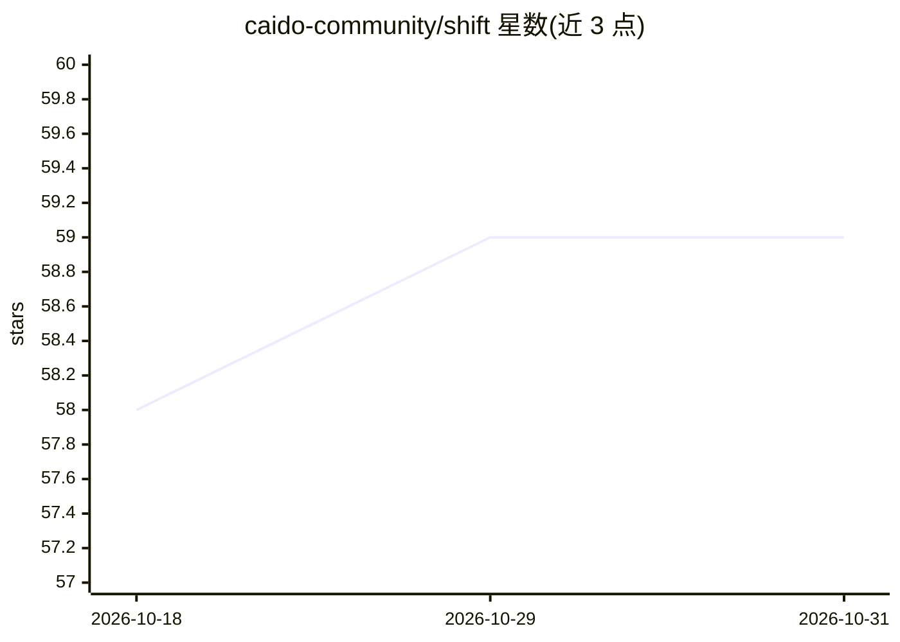

# caido-community/shift

⭐ 59 · TypeScript · MIT · 推送 2026-10-27 · [GitHub](https://github.com/caido-community/shift) · [官网](https://shiftplugin.com/)

**将 LLM 集成进 Caido 的 AI 插件：自然语言操控 HTTP 测试**

面向 Caido（Web 安全测试平台）用户的 AI 插件：将 LLM 接入 Caido UI，支持在 Replay 中以自然语言进行自由形式 HTTP 修改、查询自动上下文化，AI 可调用工具操作 Caido（生成 Match & Replace 规则、修改请求体、加 scope、生成 wordlist 等）。提供 Shift Agents 微代理框架，可构建 XSS 利用、WAF 绕过等定制代理。安装途径为 Caido Plugin Store 或 pnpm 手动构建上传；声明需外部服务（其后端与 SOTA AI 模型通信）并收集选启遥测。

## 筛选速览

| 维度 | 判定 | 备注 |
|---|---|---|
| AI 角色 | `ai-native` | 本体是模型或模型工具 |
| 许可风险 | `permissive` | MIT |
| 部署形态 | `library` | 以包/库形式分发 |
| 模型依赖 | — | README 未给出锁定关系 |
| 硬件要求 | — | 无带数字的原话,不猜 |
| 安装摩擦 | `low` | 无编译、无系统依赖或容器化 |
| 成熟度 | — | 结构信号不足 |

## 能力要点

- LLM 驱动的自由形式 HTTP 修改（Replay 中自然语言指令）
- AI 通过工具操作 Caido：Match & Replace、scope、wordlist、路径改写等
- Shift Agents 微代理框架，可定制 XSS 利用/WAF 绕过等任务代理
- 提供 Plugin Store 安装与 pnpm 手动构建两种方式

## 适用场景

- 在 Replay 中让 AI 从混淆 JS 代码生成 JSON 请求体
- 通过自然语言批量改写查询参数与请求路径
- 构建针对特定渗透任务的定制微代理

## 场景标签

`网络安全` · 领域:学习与行业

## 证据(README 行号)

> L13: Shift is an AI plugin that integrates state-of-the-art LLMs directly into Caido's UI. It allows for LLM-powered fre
> L33: Shift Agents, the new micro-agent framework for Caido users.
> L90: Shift is an AI-powered plugin, so it will be communicating with our backend and SOTA AI models to accomplish the us

## 星数曲线

2026-10-18 58 → 2026-10-31 59（+1）

---
*卡片 v1 · prompt 1.4 · 生成 2026-10-24 · 置信度 mid · 依据 README sha `a19676292b98` · [字段定义](../../DATASET.md)*
