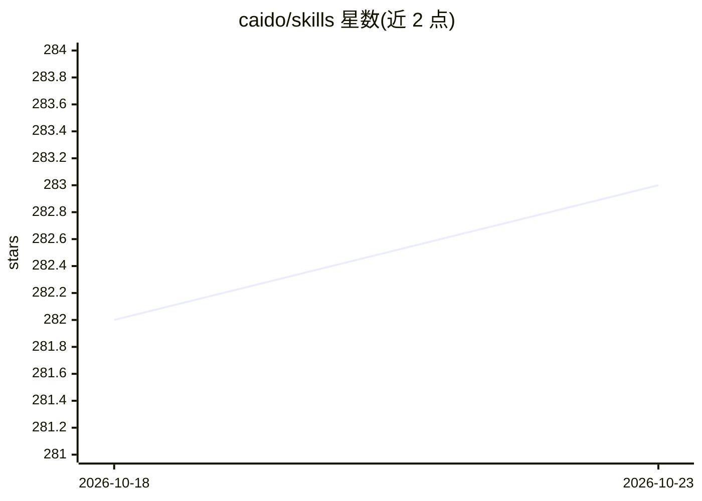

# caido/skills

⭐ 283 · TypeScript · MIT · 推送 2026-08-13 · [GitHub](https://github.com/caido/skills) · 组织维护

**Caido 官方 AI 技能集：让 agent 操作 Caido 安全测试平台**

Caido 官方维护的 AI 技能集合，供 agent 与 Caido（Web 安全测试代理工具）交互。技能通过 skills CLI 安装：pnpm dlx skills add caido/skills --skill='*'，可全局安装，具体技能列表见 README 后续章节。完整配置流程指向官方文档，属于面向 AI agent 的工具接入技能包。

## 筛选速览

| 维度 | 判定 | 备注 |
|---|---|---|
| AI 角色 | `ai-ecosystem` | LLM/agent 周边工具 |
| 许可风险 | `permissive` | MIT |
| 部署形态 | `None` |  |
| 模型依赖 | — | README 未给出锁定关系 |
| 硬件要求 | — | 无带数字的原话,不猜 |
| 安装摩擦 | `low` | 无编译、无系统依赖或容器化 |
| 成熟度 | — | 结构信号不足 |

## 能力要点

- 官方 Caido 技能集合，用于 agent 与 Caido 交互
- skills CLI 一条命令安装单个或全部技能
- 支持全局（-g）安装

## 适用场景

- 让 AI agent 在安全测试流程中调用 Caido 功能
- 为支持 skills 格式的 agent 客户端扩展 Caido 操作能力

## 场景标签

`网络安全` · 领域:学习与行业

## 证据(README 行号)

> L3: Collection of skills to interact with Caido.
> L12: pnpm dlx skills add caido/skills --skill='*'

## 星数曲线

2026-10-18 282 → 2026-10-23 283（+1）

---
*卡片 v1 · prompt 1.4 · 生成 2026-10-22 · 置信度 high · 依据 README sha `e72a0f9ab570` · [字段定义](../../DATASET.md)*
