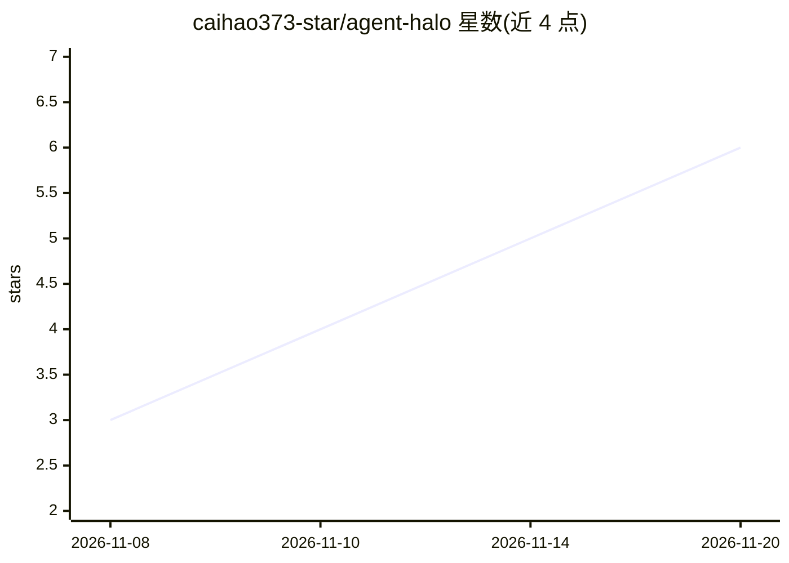

# caihao373-star/agent-halo

⭐ 6 · JavaScript · NOASSERTION · 推送 2026-11-15 · [GitHub](https://github.com/caihao373-star/agent-halo) · 个人维护 · 中文 README

**用一张光环壁纸实时监控多个本地 AI 编程智能体的状态**

由采集程序与 Wallpaper Engine 壁纸组成的监控工具：采集程序零依赖、只读本机各智能体会话记录，经 SSE 推送到光环画面；每个会话占光环一段，显示状态（思考/输出/跑工具/等待/出错）、运行的工具与目标、token 与上下文占用、规划步骤进度。支持点击回答黄色问题行与报错快捷回复。提供 Windows 安装包、源码运行和浏览器直开三种方式，画面沿用 HALOFLUX，采用 PolyForm 非商业许可。

## 筛选速览

| 维度 | 判定 | 备注 |
|---|---|---|
| AI 角色 | `ai-ecosystem` | LLM/agent 周边工具 |
| 许可风险 | `none` | NOASSERTION |
| 部署形态 | `None` |  |
| 模型依赖 | — | README 未给出锁定关系 |
| 硬件要求 | — | 无带数字的原话,不猜 |
| 安装摩擦 | `low` | 无编译、无系统依赖或容器化 |
| 成熟度 | `idea` | |

## 能力要点

- 零依赖采集程序只读本机会话记录，空闲 CPU 约 0.1%、内存约 66MB
- 同一光环同屏显示多个智能体会话的状态、工具、token 与规划进度
- 支持点击回复问题行与报错，提供重试/解释/跳过等快捷操作
- 隐私模式下消息、推理内容与工具输出永不读取，密钥字符串自动替换

## 适用场景

- 同时开多个 AI 编程智能体时一眼看清每个会话进展
- 发现某个智能体跑偏、卡住或反复失败时及时介入
- 在桌面上以壁纸形式持续跟踪智能体的 token 与规划消耗

## 场景标签

`LLM 可观测性` · 领域:评测与运维

## 证据(README 行号)

> L5: 把 HALOFLUX 的节拍光环改造成 AI 智能体的实时监控画面：本机每个正在运行的智能体会话占光环的一段，思考、输出、调用工具、等待、出错，各有不同的动态效果。
> L15: 我想要的其实是一个**监控工具**：同时开着好几个 AI 编程智能体、跑着好几个项目的时候，能一眼看清每个对话在干什么、走到哪一步、有没有跑偏。但我一直没想到合适的界面形式，最后借了 HALOFLUX 的光环，把它做成了一张**壁
> L141: |`collector/`|采集程序：Node 单进程，零依赖，读取各智能体的本地会话记录，通过 SSE 推送|

## 星数曲线

2026-11-08 3 → 2026-11-20 6（+3）

---
*卡片 v1 · prompt 1.4 · 生成 2026-11-20 · 置信度 high · 依据 README sha `9a3f75436d63` · [字段定义](../../DATASET.md)*
