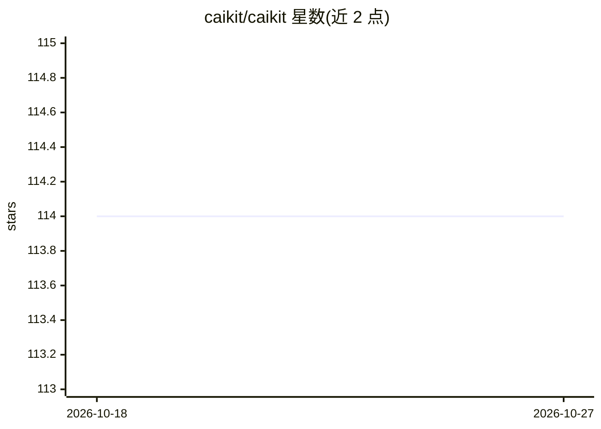

# caikit/caikit

⭐ 114 · Python · Apache-2.0 · 推送 2026-03-16 · [GitHub](https://github.com/caikit/caikit) · [官网](https://caikit.github.io/website/) · 组织维护

**面向应用开发者的 AI 模型管理工具包：统一 API 训练、推理与服务**

Caikit 是一个 Python AI 工具包，为模型作者和模型运维者提供统一的开发者 API：通过 module 与 data model 两个抽象定义模型的加载、训练与推理入口；输入输出以数据结构而非张量表示，使应用无需针对每个模型编写数据变换。支持运行训练任务、模型推理、多 GPU 分布式训练、将 transformers/tensorflow/sklearn 等社区模型合并到统一 API。模型通过 gRPC 服务器提供，可在容器运行时（含 Knative、KServe）中部署。

## 筛选速览

| 维度 | 判定 | 备注 |
|---|---|---|
| AI 角色 | `ai-ecosystem` | LLM/agent 周边工具 |
| 许可风险 | `permissive` | Apache-2.0 |
| 部署形态 | `None` |  |
| 模型依赖 | — | README 未给出锁定关系 |
| 硬件要求 | — | 无带数字的原话,不猜 |
| 安装摩擦 | `low` | 无编译、无系统依赖或容器化 |
| 成熟度 | — | 结构信号不足 |

## 能力要点

- module + data model 抽象，统一模型的加载/训练/推理入口
- 数据结构化 API（非张量进出），应用与模型可独立演进
- 支持多 GPU 分布式训练与推理任务运行
- 合并 transformers/tensorflow/sklearn 等多社区模型为通用 API

## 适用场景

- 管理数十到数百个 AI 模型并在应用中通过 API 调用
- 在应用不改动客户端的情况下替换/升级模型
- 以 gRPC/容器运行时（Knative、KServe）部署训练好的模型

## 场景标签

`MLOps` `推理引擎` `模型训练` · 领域:训练与推理

## 证据(README 行号)

> L9: Caikit is an AI toolkit that enables users to manage models through a set of developer friendly APIs. It provides a 
> L18: - Run model inference using data APIs that represent data as structures rather than tensors
> L27: Caikit provides an abstraction layer for application developers where they can consume AI models through APIs indep

## 星数曲线

2026-10-18 114 → 2026-10-27 114（+0）

---
*卡片 v1 · prompt 1.4 · 生成 2026-10-23 · 置信度 high · 依据 README sha `b8171449dd38` · [字段定义](../../DATASET.md)*
