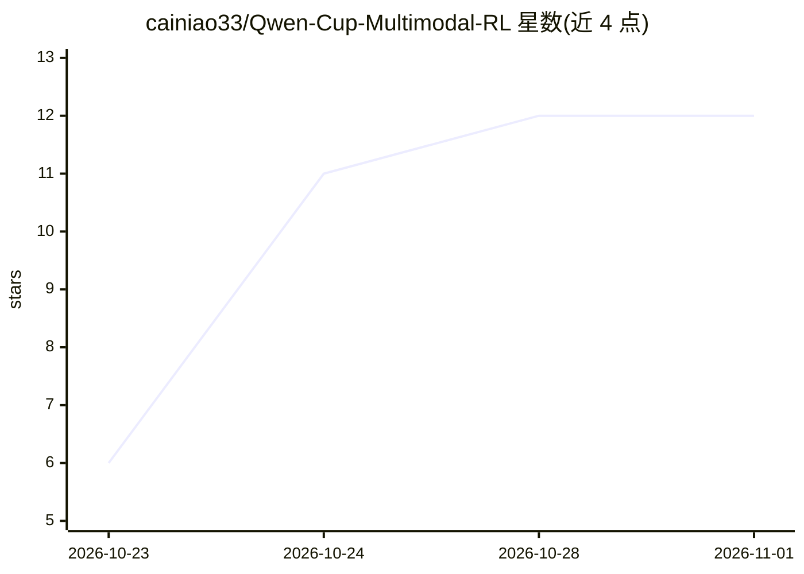

# cainiao33/Qwen-Cup-Multimodal-RL

⭐ 12 · Python · MIT · 推送 2026-10-23 · [GitHub](https://github.com/cainiao33/Qwen-Cup-Multimodal-RL) · 组织维护 · 中文 README

**千问杯多模态推理赛获奖方案：Qwen3.5-0.8B 蒸馏 SFT + GRPO 小剂量 RL**

面向阿里巴巴千问事业部发起的多模态推理竞赛的开源参赛方案仓库：在 Qwen3.5-0.8B 上构建两阶段后训练流水线——教师蒸馏 SFT（Qwen3.6-27B 经 vLLM 本地推理产出 113K 样本，精选 24,251 条 LoRA 训练）与 GRPO 30 步小剂量强化学习（TRL 0.29.1，奖励函数与官方评测脚本逐字对齐）。训练在华为 Atlas 900 NPU + torch_npu 环境完成，脚本为脱敏服务器快照。提供完整消融链、训练日志与 Hugging Face 权重下载；评测集不公开，平台分无法本地复现，不提供端到端一键复现。

## 筛选速览

| 维度 | 判定 | 备注 |
|---|---|---|
| AI 角色 | `ai-ecosystem` | LLM/agent 周边工具 |
| 许可风险 | `permissive` | MIT |
| 部署形态 | `None` |  |
| 模型依赖 | local-ok | 支持本地模型 |
| 硬件要求 | — | 无带数字的原话,不猜 |
| 安装摩擦 | `low` | 无编译、无系统依赖或容器化 |
| 成熟度 | — | 结构信号不足 |

## 能力要点

- 教师蒸馏 SFT + GRPO 小剂量 RL 两阶段后训练流水线
- 奖励函数与官方评测脚本逐字对齐的 R = acc + 0.5 × fmt 设计
- RL 剂量轴消融与 0.8B 模型灾难性遗忘的系统刻画
- GRPO 三步流水脚本完整入库，权重托管于 Hugging Face

## 适用场景

- 参赛或复现小模型 SFT+RL 后训练流水线
- 参考小模型 RL 剂量与遗忘权衡的实验设计
- 学习奖励-评测口径对齐与统计化提交决策方法

## 场景标签

`微调` `强化学习` · 领域:训练与推理

## 证据(README 行号)

> L6: > **概述**:在 Qwen3.5-0.8B 多模态模型上构建「教师蒸馏 SFT 打底 + GRPO 小剂量强化学习精细校准」两阶段后训练流水线,覆盖数值推理、计数、空间推理、物理常识、感知、关联六维能力。核心产出是一组可迁移的实
> L77: |框架|TRL 0.29.1 GRPOTrainer(use_vllm=False,HF generate 采样)|免 critic,显存友好,数值稳定|

## 星数曲线

2026-10-23 6 → 2026-11-01 12（+6）

---
*卡片 v1 · prompt 1.4 · 生成 2026-11-01 · 置信度 high · 依据 README sha `d3c518c1c2c3` · [字段定义](../../DATASET.md)*
