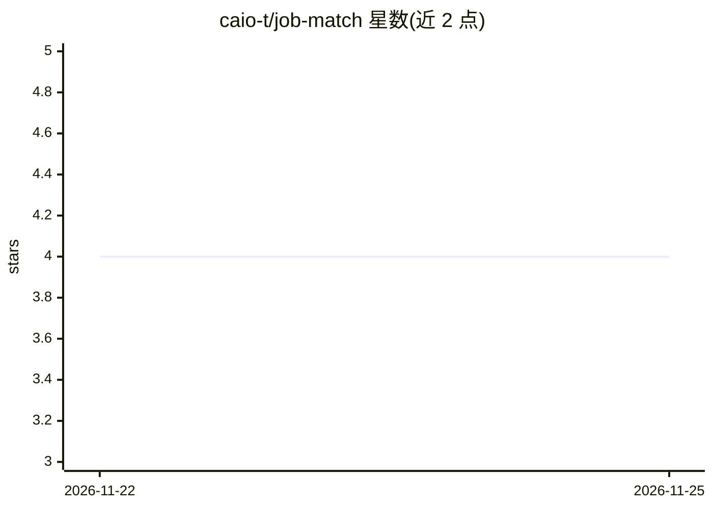

# caio-t/job-match

⭐ 4 · MIT · 推送 2026-11-20 · [GitHub](https://github.com/caio-t/job-match) · 个人维护

**求职者用的 Claude Code 技能：读简历、搜职位并按匹配度排名**

以 Claude Code 技能形式提供的求职辅助工具：从会话文件夹读取简历（PDF/DOCX/HTML/Markdown 或代码内档案），按地区调用职位来源（公司招聘页、ITJobs、LinkedIn Jobs、Gupy 等），逐条完整阅读职位描述并按技术栈、资历、地点、工作模式评分，过滤有硬性阻碍的职位，输出带匹配星级、匹配理由、能力差距和直链的 Top 10 列表；可按要求生成针对性 A4 PDF 简历。默认仅搜索和列表，不自动投递。Claude 应用版需付费计划；另有声明不受支持、需自担风险的自装版本。

## 筛选速览

| 维度 | 判定 | 备注 |
|---|---|---|
| AI 角色 | `ai-native` | 本体是模型或模型工具 |
| 许可风险 | `permissive` | MIT |
| 部署形态 | `None` |  |
| 模型依赖 | — | README 未给出锁定关系 |
| 硬件要求 | — | 无带数字的原话,不猜 |
| 安装摩擦 | `low` | 无编译、无系统依赖或容器化 |
| 成熟度 | — | 结构信号不足 |

## 能力要点

- 读取多格式简历并按完整职位描述逐条评分，输出星级匹配与差距清单
- 按地区区分职位来源（葡萄牙/巴西/远程），以公司官方招聘页为准校验聚合器结果
- 可生成针对性 A4 PDF 简历，只重排强调、不添加虚假经历
- 默认不自动投递、不存储个人数据、不登录或自动浏览禁止爬取的站点

## 适用场景

- 在本地文件夹放好简历后，用自然语言让 AI 列出匹配度最高的职位
- 针对某个职位生成突出匹配经历的定制简历
- 按地区和远程偏好筛选特定技术栈的职位

## 场景标签

`文档解析` · 领域:知识与检索

## 证据(README 行号)

> L5: > A Claude Code skill that reads your CV, searches for open jobs and ranks them by how well they fit you.
> L46: **Claude app (claude.ai, desktop, mobile) and Cowork:** open **Customize → Plugins → Discover**,
> L183: The original edition of this skill is kept in a separate repository,

## 星数曲线

2026-11-22 4 → 2026-11-25 4（+0）

---
*卡片 v1 · prompt 1.4 · 生成 2026-11-22 · 置信度 high · 依据 README sha `219301bfd399` · [字段定义](../../DATASET.md)*
