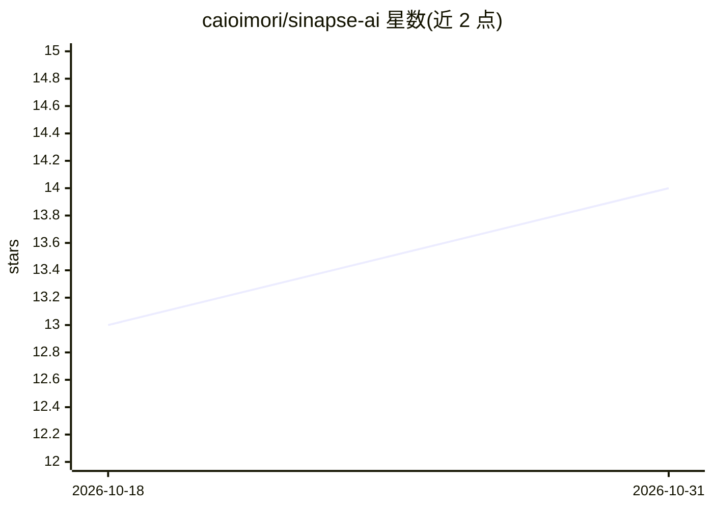

# caioimori/sinapse-ai

⭐ 14 · JavaScript · MIT · 推送 2026-10-18 · [GitHub](https://github.com/caioimori/sinapse-ai) · [官网](https://www.npmjs.com/package/sinapse-ai) · 个人维护

**为 Claude Code 与 Codex 安装治理型 agent 编排的框架**

面向软件交付的 agent 编排框架：通过 npx 将 172 个 agent、37 个 skills、规则与 hooks 安装到项目中，使 Claude Code 与 Codex 共用同一目录与工程流程，覆盖 briefing、路由、story、实现、QA 到交付。提供 11 篇治理条款、20 条 hooks 注册与 9 个 Codex 事件的 quality gates，以及四层所有权模型区分不可变核心与项目自有内容。要求 Node 18+、npm 9+ 和至少一个受支持的 CLI。

## 筛选速览

| 维度 | 判定 | 备注 |
|---|---|---|
| AI 角色 | `ai-ecosystem` | LLM/agent 周边工具 |
| 许可风险 | `permissive` | MIT |
| 部署形态 | `library` | 以包/库形式分发 |
| 模型依赖 | — | README 未给出锁定关系 |
| 硬件要求 | — | 无带数字的原话,不猜 |
| 安装摩擦 | `low` | 无编译、无系统依赖或容器化 |
| 成熟度 | — | 结构信号不足 |

## 能力要点

- 17 个 squad、172 个 agent、37 个 skills 安装至项目
- Claude Code 与 Codex 双 CLI 对等，adapters 经漂移校验
- 11 篇治理条款由 hooks 与验证器转为质量门禁
- 分层所有权模型：核心不可变、项目内容不被重装覆盖

## 适用场景

- 在 Claude Code 或 Codex 中以统一流程管理软件交付任务
- 为存量项目做债务诊断、风险评估与增量计划
- 安全场景下执行威胁建模、secrets 校验与 pre-deploy 审查

## 场景标签

`多智能体` `Agent 框架` · 领域:Agent 开发

## 证据(README 行号)

> L25: SINAPSE AI é um framework de orquestração que instala agentes, skills, regras e
> L29: Ele não substitui sua CLI ou sua LLM. Ele transforma uma sessão de IA em um

## 星数曲线

2026-10-18 13 → 2026-10-31 14（+1）

---
*卡片 v1 · prompt 1.4 · 生成 2026-10-31 · 置信度 high · 依据 README sha `c55b3a895d03` · [字段定义](../../DATASET.md)*
