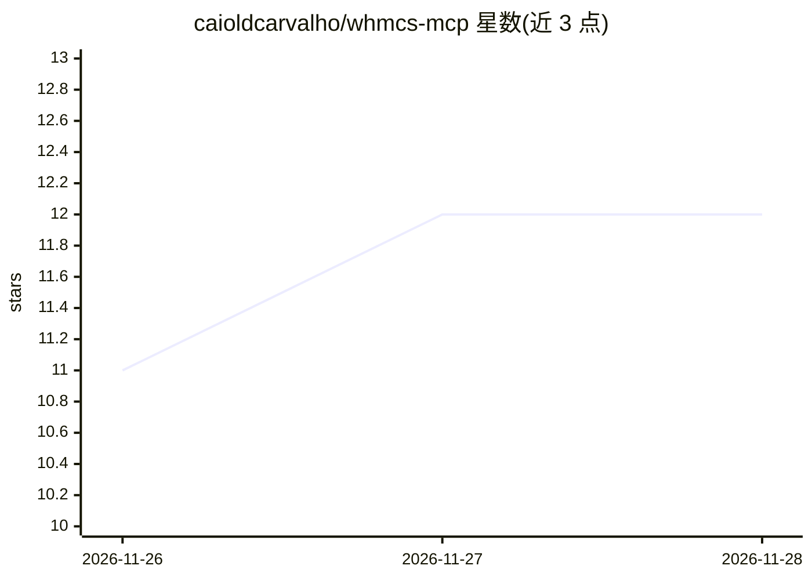

# caioldcarvalho/whmcs-mcp

⭐ 12 · JavaScript · MIT · 推送 2026-07-27 · [GitHub](https://github.com/caioldcarvalho/whmcs-mcp) · 个人维护

**面向 WHMCS 主机商的 MCP 服务器：让 Claude 管理客服与账务**

连接 WHMCS API 的 MCP 服务器，实现 34 个工具，覆盖工单创建与回复、客户查询、产品与订单列表、发票检索、欠款与账单缺口分析、服务挂起/开通、订单审批等托管运营操作。支持 API Identifier/Secret 或管理员账号密码（自动 MD5 哈希）两种认证；针对 WHMCS 非 UTF-8 字节导致的 JSON 编码报错，自动降级为 XML 请求并解析为相同结构。响应默认输出 Markdown 表格，同时提供 structuredContent。要求 Node.js >= 18 与已开通 API 的 WHMCS 账户。

## 筛选速览

| 维度 | 判定 | 备注 |
|---|---|---|
| AI 角色 | `ai-ecosystem` | LLM/agent 周边工具 |
| 许可风险 | `permissive` | MIT |
| 部署形态 | `library` | 以包/库形式分发 |
| 模型依赖 | locked-api |  |
| 硬件要求 | — | 无带数字的原话,不猜 |
| 安装摩擦 | `low` | 无编译、无系统依赖或容器化 |
| 成熟度 | — | 结构信号不足 |

## 能力要点

- 实现并测试了 34 个 MCP 工具，覆盖工单、客户、订单、发票、服务管理
- WHMCS JSON 编码报错时自动改用 XML 重试并解析为相同结构
- 支持 API 密钥与管理员账号密码两种认证方式
- 响应默认 Markdown 表格，可请求 JSON 结构化字段

## 适用场景

- 让 Claude 查询和回复 WHMCS 客服工单
- 排查客户的未付发票与缺失账单月份
- 通过对话执行服务的挂起、解除挂起与订单处理

## 场景标签

`AI 助手` · 领域:对话与助手

## 证据(README 行号)

> L3: MCP (Model Context Protocol) server for full integration with the WHMCS API.
> L106: claude mcp add whmcs \

## 星数曲线

2026-11-26 11 → 2026-11-28 12（+1）

---
*卡片 v1 · prompt 1.4 · 生成 2026-11-26 · 置信度 high · 依据 README sha `7717b41e0146` · [字段定义](../../DATASET.md)*
