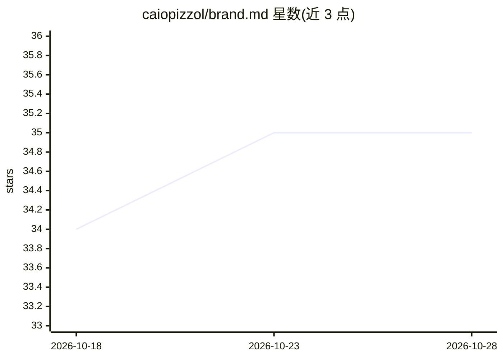

# caiopizzol/brand.md

⭐ 35 · HTML · MIT · 推送 2026-08-05 · [GitHub](https://github.com/caiopizzol/brand.md) · [官网](https://thebrand.md) · 个人维护

**面向 AI 工具的品牌身份文件开放标准与 Claude Code 插件**

定义 BRAND.md 开放标准：在项目中放置品牌文件，为 AI 工具提供品牌战略、语气、视觉原语与治理规则等持久上下文，类比 AGENTS.md 之于编码指令。格式含 Strategy/Voice/Visual/可选 Governance 四层，支持子品牌文件继承父文件，无 specVersion 的文件按 0.2 版解释。同时以 Claude Code 插件形式分发，提供 marketplace 安装或本地克隆测试两种方式，并区分与 DESIGN.md 的职责边界。

## 筛选速览

| 维度 | 判定 | 备注 |
|---|---|---|
| AI 角色 | `ai-ecosystem` | LLM/agent 周边工具 |
| 许可风险 | `permissive` | MIT |
| 部署形态 | `None` |  |
| 模型依赖 | — | README 未给出锁定关系 |
| 硬件要求 | — | 无带数字的原话,不猜 |
| 安装摩擦 | `low` | 无编译、无系统依赖或容器化 |
| 成熟度 | — | 结构信号不足 |

## 能力要点

- 定义 BRAND.md 开放标准，四层结构（Strategy/Voice/Visual/Governance）
- 支持稀疏的产品与子品牌文件继承父级品牌文件
- 以 Claude Code 插件形式提供，可用 marketplace 或本地克隆运行

## 适用场景

- 为 AI 编码/设计工具提供品牌策略与语气上下文
- 维护多设计系统共享的单一品牌身份定义
- 通过 Claude Code 插件快速校验或生成品牌文件

## 场景标签

`提示工程` · 领域:Agent 开发

## 证据(README 行号)

> L5: `BRAND.md` lives in a project and gives AI tools durable context about how a brand
> L6: looks, sounds, and behaves. Like `AGENTS.md` provides coding instructions,
> L12: Add the Claude Code marketplace, install the plugin, then invoke the skill:

## 星数曲线

2026-10-18 34 → 2026-10-28 35（+1）

---
*卡片 v1 · prompt 1.4 · 生成 2026-10-25 · 置信度 high · 依据 README sha `c1bcb07eca40` · [字段定义](../../DATASET.md)*
