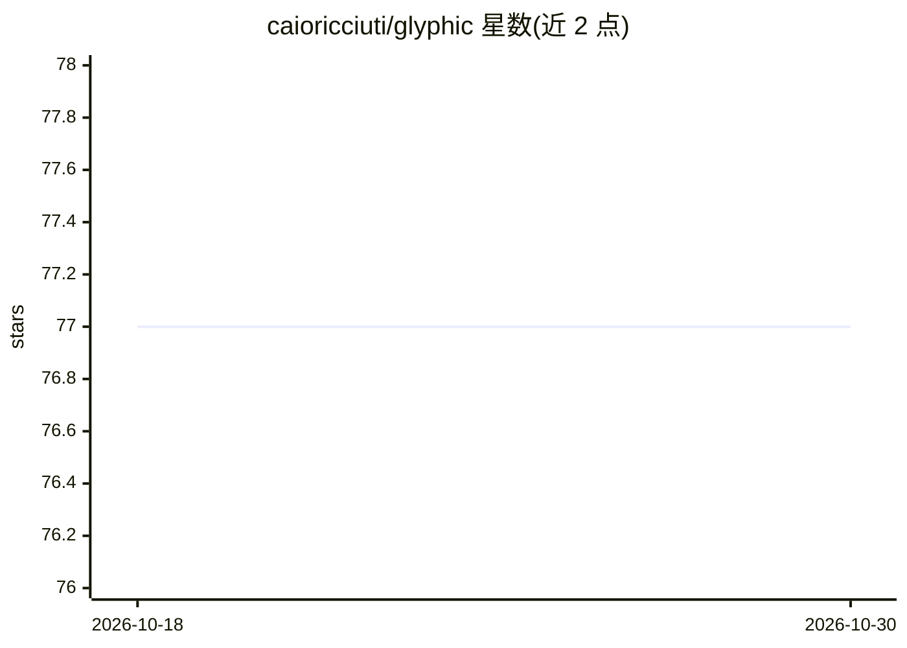

# caioricciuti/glyphic

⭐ 77 · Svelte · AGPL-3.0 · 推送 2026-08-31 · [GitHub](https://github.com/caioricciuti/glyphic) · 个人维护

**Claude Code 的桌面图形管理界面：可视化管理配置与文件**

基于 Tauri v2 与 Svelte 5 的本地桌面应用，为 Claude Code（Anthropic 的 AI 编码助手）提供图形化管理：可视化编辑 settings.json、CLAUDE.md 指令、22 种 hooks、MCP 服务器、技能与 agent、规则、插件市场浏览、Git 操作、内嵌多标签终端、会话回放、拖拽式工作流管道（14 种节点）以及 token 用量与成本统计。读写 Claude Code 原有配置文件，无服务端、无账号、无遥测，全部本地运行。需已安装 claude CLI。

## 筛选速览

| 维度 | 判定 | 备注 |
|---|---|---|
| AI 角色 | `ai-ecosystem` | LLM/agent 周边工具 |
| 许可风险 | `viral` | AGPL-3.0 |
| 部署形态 | `desktop` | 安装包/桌面程序 |
| 模型依赖 | locked-api |  |
| 硬件要求 | — | 无带数字的原话,不猜 |
| 安装摩擦 | `low` | 无编译、无系统依赖或容器化 |
| 成熟度 | — | 结构信号不足 |

## 能力要点

- 可视化编辑 Claude Code 的 settings.json、CLAUDE.md、hooks、MCP、技能与 agent 等配置文件
- 内嵌 PTY + xterm.js 多标签终端运行 Claude Code
- Svelte Flow 拖拽式工作流管道（14 种节点，支持 cron 调度与运行历史回放）
- 从 ~/.claude/history.jsonl 读取数据做统计、token 成本与预算告警分析

## 适用场景

- 不想手改 JSON 与 markdown 文件，用图形界面管理 Claude Code 配置
- 浏览和安装 Claude Code 插件市场中的插件与模板
- 查看会话历史、token 成本与缓存效率统计
- 通过可视化管道编排 Claude 提示词与命令的自动化工作流

## 场景标签

`工作流自动化` `LLM 可观测性` · 领域:效率与自动化

## 证据(README 行号)

> L5:  The desktop app for managing Claude Code
> L18: Glyphic gives you a visual interface to configure, manage, and use Claude Code -- the AI coding assistant from Anth

## 星数曲线

2026-10-18 77 → 2026-10-30 77（+0）

---
*卡片 v1 · prompt 1.4 · 生成 2026-10-24 · 置信度 high · 依据 README sha `b30d0b3c7b97` · [字段定义](../../DATASET.md)*
