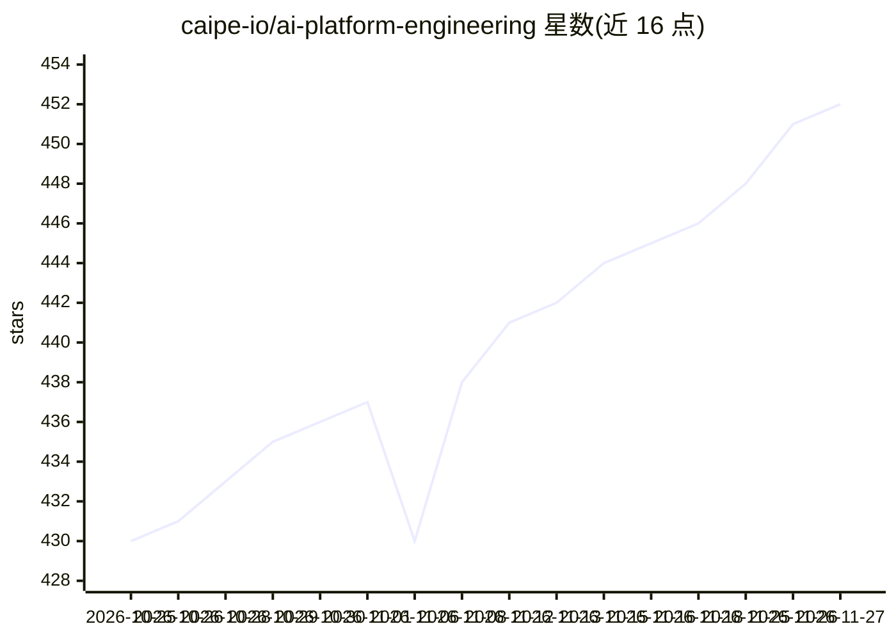

# caipe-io/ai-platform-engineering

⭐ 452 · TypeScript · Apache-2.0 · 推送 2026-11-26 · [GitHub](https://github.com/caipe-io/ai-platform-engineering) · [官网](https://caipe.io) · 组织维护

**构建、治理与运行 AI agent 及工作流的开源平台**

CAIPE 定位为面向平台工程的 AI 平台，覆盖 agent 的创建、部署、治理与运行全周期。其机制组合包括：agent 运行时执行、工作流自动化、技能与 MCP 集成、企业知识接入、身份与授权、可观测性，以及多渠道体验。项目提供每周例会、CNCF Slack 社区频道与项目文档，采用 Apache-2.0 许可证，接受社区贡献。README 中未包含具体安装命令或硬件要求。

## 筛选速览

| 维度 | 判定 | 备注 |
|---|---|---|
| AI 角色 | `ai-ecosystem` | LLM/agent 周边工具 |
| 许可风险 | `permissive` | Apache-2.0 |
| 部署形态 | `None` |  |
| 模型依赖 | — | README 未给出锁定关系 |
| 硬件要求 | — | 无带数字的原话,不猜 |
| 安装摩擦 | `low` | 无编译、无系统依赖或容器化 |
| 成熟度 | — | 结构信号不足 |

## 能力要点

- 覆盖 agent 构建、部署、治理、运行全周期
- 集成 MCP 与技能机制、企业知识与身份授权
- 提供可观测性与多渠道体验
- 每周例会与 CNCF Slack 社区

## 适用场景

- 平台工程团队搭建 agent 运行平台
- 企业对 agent 与工作流做治理和授权管控
- 接入 MCP 与企业知识构建 agentic 工作流

## 场景标签

`工作流自动化` `多智能体` `LLM 可观测性` · 领域:Agent 开发

## 证据(README 行号)

> L9: **CAIPE** (pronounced like *cape* 🦸) is an open-source AI platform for building, deploying, governing, and operating
> L3: License: Apache-2.0

## 星数曲线

2026-10-25 430 → 2026-11-27 452（+22）

---
*卡片 v1 · prompt 1.4 · 生成 2026-11-25 · 置信度 high · 依据 README sha `c3c0b7821cd0` · [字段定义](../../DATASET.md)*
